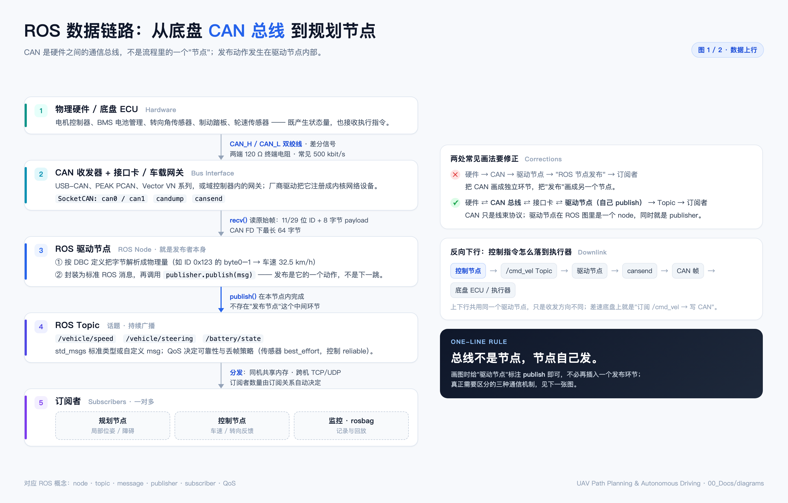
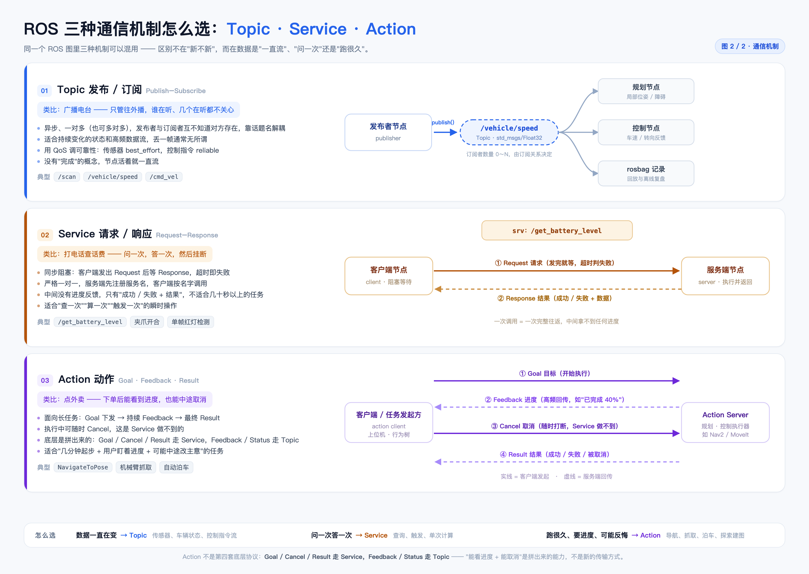

(2026-11 · CAN 总线 → ROS 通信) 读图答疑 Q1–Q7：差分信号、帧 ID 与多传感器时间同步

来源：先画了「底盘 CAN → 驱动节点 → Topic → 订阅者」和「Topic / Service / Action」两张架构图，画的过程中连续追问了七个问题。这份笔记按**提问顺序**逐条归档答案，并标明每个结论落在图上的哪个位置——所以它不是一篇 CAN 教程，而是**这两张图的注释与答辩**。

> 排版版：同目录 `2026-11-CAN总线到ROS-读图答疑-Q1-Q7.pdf`（A4，9 页，封面 + 分页 + 图表编号）。想从头读到尾看 PDF，想检索摘抄看本文件。
>
> **图 ↔ 疑问对照**（文件名里就带着答案）：
> - `assets/2026-11-CAN链路-Q1-Q5-图1-CAN链路.png` → 回答 **Q1–Q5**
> - `assets/2026-11-CAN链路-Q1-Q5-图2-通信机制.png` → 回答 **Q7**
> - **Q6**（传感器时间同步）没有配图，只在正文第六节
>
> PDF、Markdown 两个文件名的 `Q1-Q7` 表示这两张图加文字一共回答了 7 个问题。

一句话：CAN 用两根线的**电压差**传 0/1，用帧里的**ID**说明"这是什么数据"而不是"发给谁"，靠**显性位**做无破坏仲裁；ROS 侧只负责按 ID 解析、打时间戳、发 Topic。真正的"数据融合"和"时间同步"都不在总线上，而在订阅端和算法层。

────────────────────────────

〇、这份笔记回答的七个疑问（先看这张表）

| # | 疑问（原话的意思） | 一句话答案 | 回答它的图 |
|---|---|---|---|
| Q1 | CAN_H 和 CAN_L 是什么东西 | 一对双绞线，高/低两根，差分传输的物理载体 | 图 1 · 第二节 |
| Q2 | 差分信号又是什么 | 不看单根线对地的绝对电压，只看两根线的差值 | 图 1 · 第二节 |
| Q3 | 都并联在一条线上，怎么知道这帧是谁的 | 靠帧头 ID 做**内容寻址**，接收端用硬件过滤器按需取 | 图 1 · 第三节 |
| Q4 | 0 和 1 怎么表达"车速 60 km/h" | 二进制 → 字节 → 按 DBC 切位、乘系数、加偏移 | 图 1 · 第四节 |
| Q5 | 总线会不会把几个传感器拼成一包 | 不会，**分时复用**，一帧只装一件事 | 图 1 · 第五节 |
| Q6 | 传感器不同步，ROS 消息怎么对齐 | 打时间戳 + 软件近似同步 + 硬件对表 + 算法预测 | 无配图 · 第六节 |
| Q7 | Topic / Service / Action 三种通信怎么选 | 一直流用 Topic、问一次用 Service、长任务用 Action | 图 2 · 第八节 |

────────────────────────────

一、Q1：CAN_H / CAN_L 是什么

**是线，不是信号名。** CAN 线束里最核心的就是两根线：CAN_H（High）与 CAN_L（Low），通常做成一对**双绞线**（互相缠绕）。

为什么要绞：汽车底盘里有电机、DC-DC、火花塞，电磁干扰很强。双绞让两根线在空间上几乎处在同一个干扰场里，干扰会**同时、等量**地叠加到两根线上（共模），后面一减就抵消了。

拓扑是**总线型并联**，不是星形、也不是菊花链的"串联"：

```
节点 A                节点 B                节点 C
┌──────┐             ┌──────┐             ┌──────┐
│CAN_H ├─────────────┤CAN_H ├─────────────┤CAN_H │
│      │             │      │             │      │
│CAN_L ├─────────────┤CAN_L ├─────────────┤CAN_L │
└──────┘             └──────┘             └──────┘
   └── 总线两端各接一个 120 Ω 终端电阻，吸收信号反射 ──┘
```

容易记错的点：**120 Ω 只在总线最远的两端各一个**，中间节点不接；不是每个设备都接，也不是每个设备都不接。

────────────────────────────

二、Q2：差分信号是什么

**是一种"看差值"的传输方式**，而不是"看某根线是多少伏"。CAN 收发器把总线状态编码成两个电平：

| 状态 | 逻辑值 | CAN_H | CAN_L | 差值 (H−L) | 俗称 |
|---|---|---|---|---|---|
| 显性 Dominant | 0 | ≈ 3.5 V | ≈ 1.5 V | ≈ 2 V | 强、大嗓门 |
| 隐性 Recessive | 1 | ≈ 2.5 V | ≈ 2.5 V | ≈ 0 V | 弱、小声 |

接收端只做一件事：`V_diff = CAN_H − CAN_L`，≈2 V 读 0，≈0 V 读 1。

为什么抗干扰（这是差分的全部意义）：

```
电机启动，把整条线束的电位整体抬高 2 V（共模干扰）
单端信号：0 V → 2 V，接收端可能误判
差分信号：H 3.5→5.5 V，L 1.5→3.5 V
          差值 5.5 − 3.5 = 2 V   ← 一点没变，逻辑 0 依旧是 0
```

所以"差分"三个字拆开就是：**两根线一起变（共模）不影响结果，只有两根线相对变化才携带信息**。同理，绞距、屏蔽层、终端电阻，都是围绕"让两根线经历完全相同的干扰"这一个目标服务的。

────────────────────────────

三、Q3：并联在一条线上，怎么知道这帧是谁的

关键在于：**CAN 上跑的不是连续模拟量，而是打包好的帧（Frame），每帧开头都有 ID。**

1. **ID 是"内容标识"，不是"目的地地址"**
   `ID 0x100 = 车速`、`ID 0x200 = 方向盘转角`。发送方不指定收件人——这是**广播**语义，和以太网"发给某个 MAC/IP"完全不同。

2. **接收端靠硬件过滤器筛选**
   ```
   总线上混杂流过：0x100 车速 | 0x300 车门 | 0x200 转角 | 0x100 车速 ...
                        │           │          │
   域控制器 CAN 控制器：只放行 0x100、0x200（其余在硬件层丢弃，不占 CPU）
                        ↓
   ROS 驱动节点：解析 0x100 → /vehicle/speed
   ```
   所以"怎么接收所有传感器的信号"这个问法本身要修正：**它并不接收"所有"，而是只接收自己配置关心的那些 ID**。

3. **各发各的，靠时间片轮流**
   ```
   时刻 1：轮速 ECU  → ID 0x100，车速 60
   时刻 2：转角 ECU  → ID 0x200，转角 30°
   时刻 3：轮速 ECU  → ID 0x100，车速 61（周期 10 ms 又到了）
   ```
   线上永远是"一帧一帧前后排开"，不存在几家的数据混在同一帧里。

4. **顺便理解仲裁（为什么不会撞车）**
   两个节点同时开口时，逐位比较 ID：谁发**显性 0**、对方发**隐性 1**，总线呈现显性，发隐性的那个立刻退出、下次再来，发显性的毫无感知地发完。这叫**非破坏性仲裁**，所以 **ID 数值越小优先级越高**——刹车、碰撞这类安全帧的 ID 一定排在最前面。

────────────────────────────

四、Q4：0 和 1 怎么表达"车速 60 km/h"

分四步，缺一不可：

1. **物理量 → 整数**：60 km/h 按约定系数（比如 1 km/h / bit）变成整数 60。
2. **整数 → 二进制**：60 = `0011 1100`，塞进 1 个字节。
3. **字节 → 信号**：一帧可以塞多个信号，谁占哪几位由 **DBC 文件**规定（起始位、长度、字节序 Intel/Motorola、系数 factor、偏移 offset、单位）。
4. **信号 → 帧**：加上 ID、长度、CRC 等，形成完整帧。

一帧的骨架（经典 CAN）：

```
[SOF 1b] [仲裁段 ID 11b + RTR] [控制段 DLC 4b] [数据段 0~8 B] [CRC 15b] [ACK] [EOF 7b]
             ↑ 这是什么数据        ↑ 有几个字节      ↑ 真正的数值
```

DBC 的一行大概长这样（示意）：

```
BO_ 256 VehicleStatus: 8 ECU_Wheel
 SG_ VehicleSpeed : 0|16@1+ (0.01,0) [0|300] "km/h"  DomainController
        ↑起始位 ↑长度 ↑字节序 ↑系数 ↑偏移 ↑范围 ↑单位
```

几条边界要记住：
- 经典 CAN 一帧**最多 8 字节**，CAN FD 扩到 **64 字节**，且数据段可以提速；
- 它的定位是**控制与状态**（车速、转角、档位、故障码），不是文件传输；
- 相机图像、激光点云走**车载以太网 / LVDS / GMSL**，绝不会走 CAN —— 500 kbit/s 的带宽连一帧小图都塞不下。

────────────────────────────

五、Q5：总线不会把多个传感器"拼"成一包

这是画图时最容易脑补错的地方。正确的心智模型是**分时复用的广播**，像微信群：谁有话说谁发一条，不存在"把几个人的话合成一句"。

```
物理层：   [0x100 车速] [0x200 转角] [0x300 车门] [0x100 车速] ...
              ↑独立帧      ↑独立帧      ↑独立帧      ↑独立帧

接收端：   按 ID 分别更新各自的变量，互不干扰
              vehicle_speed = 60
              steering_angle = 30

融合点：   发生在订阅端/算法层（ROS 节点里），不在总线上
```

推论有三条，都直接影响架构图怎么画：
1. **CAN 不是流程里的一个"节点"**，它是链路/介质；画成方框会让人误以为数据在总线里被加工过。
2. **驱动节点是"多路解复用器"**：一个节点、多个 publisher、多个 Topic，不是"一个 Topic 装所有传感器"。
3. **"融合"是订阅端的事**：规划节点同时订阅 `/vehicle/speed` 与 `/can/steering`，在代码里组合——这一步在 ROS 图里才是真正的融合节点。

────────────────────────────

六、Q6：传感器不同步，ROS 里怎么对齐（1 → 6 分层）

先把事实摆清楚：轮速 ~100 Hz（10 ms）、IMU ~200 Hz（5 ms）、相机 ~30 Hz（33 ms），**相位天然错开，且永远不会自动对齐**。工程上是六层手段叠加使用，从下往上：

**1. 接受"物理上就是不同步"**
CAN 分时复用决定了任一时刻总线上只有一帧。同步不是 CAN 的职责，别指望在总线层解决。

**2. 每条消息必须带时间戳 `header.stamp`**
驱动节点解析完立刻打戳，优先用**采集时刻**（ECU/传感器自己打的），退而求其次才是**接收时刻**。这是跨节点对齐的唯一契约——所以 ROS 消息几乎都带 header，不是装饰。

**3. 软件层近似同步：`message_filters`**
`ApproximateTimeSynchronizer` 在缓冲区里找时间戳最接近的一组（容差常设 10 ms），凑齐才触发回调。代价是**引入延迟**：容差越大越容易配对，也越滞后；`ExactTime` 要求完全相等，实际几乎命不中。

**4. 硬件层对表：PPS / PTP / 硬触发**
- **PPS 秒脉冲**：GNSS/RTK 在整秒发脉冲，全网设备同时"对表"；
- **PTP（IEEE 1588）**：走车载以太网，把时钟同步到微秒级；
- **硬件触发**：域控制器直接发 Trigger，强制相机曝光、LiDAR 扫描落在同一微秒。
这一层解决的是"大家的表是不是同一块表"，否则第 2、3 条都无从谈起。

**5. 算法层：用运动模型填补空隙**
卡尔曼滤波 / ESKF 做两件事：用 IMU 角速度、加速度**预测** T₁→T₂ 之间怎么动；用最新观测**更新**修正。离散、异步的观测由此被拼成连续的状态估计——这才是"融合"的真正含义。

**6. 空间传感器还要运动补偿（Deskewing）**
LiDAR 转一圈 100 ms，这期间车已经往前走了，整帧点云本身就是歪的。要用同时段的 IMU + 轮速把点云"拉回"同一参考时刻；相机的高速运动模糊、卷帘快门畸变同理。

各层职责一张表：

| 层 | 解决什么 | 典型手段 | 量级 |
|---|---|---|---|
| 物理层（CAN） | 不解决，只保证帧完整 | 差分 + 仲裁 + CRC | — |
| 消息层 | 这份数据"几点发生" | `header.stamp` | ms |
| 软件层 | 哪几条算"同一时刻" | `message_filters` | 10 ms 级 |
| 硬件层 | 大家的钟是不是一块钟 | PPS / PTP / 硬触发 | µs 级 |
| 算法层 | 用运动模型补空隙 | KF / ESKF 预测-更新 | 连续 |
| 感知层 | 一帧数据自身的畸变 | Deskewing 运动补偿 | 帧内 |

工程结论：**驱动节点只做三件事——解析字节、打时间戳、发 Topic**，它不做融合；融合放在订阅端与算法层。这一点正好决定了图 1 里驱动节点出去的是"多个独立 Topic"，而不是"一个融合后的大消息"。

────────────────────────────

七、图 1：CAN 链路怎么画才对（回答 Q1–Q5）



这张图回答的是 Q1～Q5，落点如下：

| 图上位置 | 对应疑问 | 画法要点 |
|---|---|---|
| 第 2 框 CAN 收发器 + 接口卡 | Q1/Q2 | 总线在**链路**上，不在流程节点里；SocketCAN 的 `can0` 才是软件看见的入口 |
| 第 3 框 ROS 驱动节点 | Q3/Q4 | 标注"就是发布者本身"：按 DBC 解析 → 封装 msg |
| `publish()` 那条箭头 | Q5 | 发布是**节点内的一次函数调用**，没有"发布节点"这一跳 |
| 第 4 框 Topic | Q3 | 多路独立 Topic，不是一个"大杂烩"消息 |
| 右侧「反向下行」 | — | 控制指令原路返回：`/cmd_vel` → 驱动节点 → `cansend` → 执行器 |

画错过的两版（留作对照，避免再犯）：
- ✗ 硬件 → CAN → 驱动节点 → "ROS 节点发布" → 订阅者：把 CAN 画成节点，把发布画成独立的中间环节。
- ✓ 硬件 ⇄ CAN 总线 ⇄ 接口卡 ⇄ 驱动节点（自己 publish）→ Topic → 订阅者。

一句话记法：**总线不是节点，节点自己发。**

────────────────────────────

八、图 2：Topic / Service / Action 怎么选（回答 Q7）



这张图回答的是"规划告诉控制往左转，该用哪种通信"，以及"上位机让系统导航到 A 点，又该用哪种"：

| 机制 | 类比 | 通道 | 判据 |
|---|---|---|---|
| **Topic** | 广播电台 | 发布者 → 话题 → N 个订阅者 | 数据一直在变，丢一帧无所谓 |
| **Service** | 打电话查话费 | ① Request 阻塞 → ② Response | 问一次答一次，中间没有进度 |
| **Action** | 点外卖 | ① Goal → ② Feedback ← ③ Cancel → ④ Result | 跑得久、要看进度、可能中途反悔 |

两个容易答错的点：
1. "规划让控制左转"用 **Topic** 就行（`/cmd_vel` 这类持续指令流），不需要 Service；
2. "上位机下发一次导航任务"用 **Action**（Nav2 的 `NavigateToPose`），不是 Service —— 因为要进度、要能取消。

底层的真相：**Action 不是第四套协议**。Goal / Cancel / Result 走 Service，Feedback / Status 走 Topic。"能看进度 + 能取消"是拼出来的能力。

────────────────────────────

九、画图时最容易画错的三处（自查清单）

1. **把 CAN 画成一个方框节点** → 它是链路与介质，应画在箭头上（线束 + 收发器），不是流程里的一站。
2. **在驱动节点后面再加一个"发布"环节** → publish 是节点自己的动作，箭头标注函数名即可。
3. **在总线上画"数据融合"** → 融合只发生在订阅端/算法层；总线上永远是一帧一件事。

────────────────────────────

十、附：图片与可编辑源文件

| 文件 | 说明 |
|---|---|
| `assets/2026-11-CAN链路-Q1-Q5-图1-CAN链路.png` | 图 1，回答 Q1–Q5，2880×1840，2× 高清 |
| `assets/2026-11-CAN链路-Q1-Q5-图2-通信机制.png` | 图 2，回答 Q7，3000×2128，2× 高清 |
| `assets/_make_can_chain.html` | 图 1 的源文件（单文件 HTML，无外部依赖） |
| `assets/_make_ros_comms.html` | 图 2 的源文件 |
| `assets/_make_note_pdf.html` | 本笔记 PDF 版的排版源文件（改它可重出 PDF） |
| `2026-11-CAN总线到ROS-读图答疑-Q1-Q7.pdf` | 排版后的 A4 版本（9 页） |

改文案/配色后重出图（macOS，Chrome 无头渲染）：

```bash
CHROME="/Applications/Google Chrome.app/Contents/MacOS/Google Chrome"
cd "assets"   # 在本笔记所在目录执行

"$CHROME" --headless=new --disable-gpu --hide-scrollbars \
  --force-device-scale-factor=2 --window-size=1440,920 \
  --screenshot="图1-CAN链路-Q1-Q5.png" "file://$PWD/_make_can_chain.html"

"$CHROME" --headless=new --disable-gpu --hide-scrollbars \
  --force-device-scale-factor=2 --window-size=1500,1064 \
  --screenshot="图2-通信机制-Q7.png" "file://$PWD/_make_ros_comms.html"
```

把 `--force-device-scale-factor` 改成 3 可出印刷级 3× 图；要矢量就把 HTML 打印成 PDF。

排版版 PDF 重出（改了 `assets/_make_note_pdf.html` 之后）：

```bash
CHROME="/Applications/Google Chrome.app/Contents/MacOS/Google Chrome"
"$CHROME" --headless=new --disable-gpu --no-pdf-header-footer \
  --print-to-pdf="2026-11-CAN总线到ROS-读图答疑-Q1-Q7.pdf" \
  "file://$PWD/assets/_make_note_pdf.html"
```
