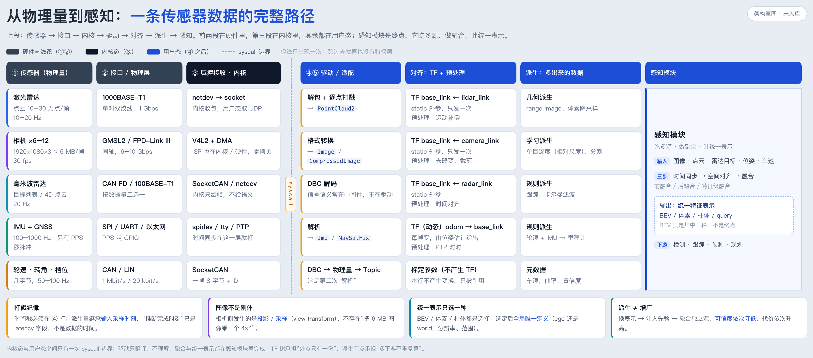

(2026-11 · 传感器到感知) 架构讲解：一条数据的七段路径

来源：从“这些线接进系统后，是不是用户态驱动解析完、按格式发出去”这个问题出发，中间经过坐标变换、数据派生两轮追问，最后把一颗传感器的完整路径画成了一张七段架构图。这份文档逐段解释它。

一句话：**一条数据走七段——传感器、接口、内核、驱动、对齐、派生、感知；中间只有一次 syscall 边界，跨过去之后驱动只翻译不理解，对齐靠 TF 不靠搬数据，感知是多源汇入后的统一表示。**

> 排版版：同目录 `2026-11-传感器到感知-架构讲解.pdf`（A4，11 页，无封面页码以外的装饰）
> 图在 `assets/` 下：`2026-11-传感器到感知-图1-从物理量到感知.png`（3306×1458）
> 生成脚本：`assets/_make_sensor2perception_fig.html`（出图）、`assets/_make_sensor2perception_note.html`（出 PDF）

────────────────────────────

〇、这张图回答什么

| # | 文件 | 回答的问题 | 一句话结论 |
|---|---|---|---|
| 1 | `assets/2026-11-传感器到感知-图1-从物理量到感知.png` | 一份数据从物理量到感知经过谁的手 | 七段、一条 syscall 边界；只有 ④ 之后是你写的代码 |

读法三种：**横着读**一行是一条链路，**竖着读**一列是一类工作，**看边界**则只有一条橙虚线卡在 ③ 与 ④ 之间。

────────────────────────────

一、全景：七段与一条边界



| 段 | 落在哪 | 谁的地盘 | 换它要动谁 |
|---|---|---|---|
| ① 传感器 | 传感器内部 | 硬件 / 固件 | 换传感器、重标定 |
| ② 接口 | 线缆 / 收发器 | 硬件 | 换线束、换收发器 |
| ③ 内核 | 内核态 | 内核 / 驱动模块 | 改驱动模块、升级内核 |
| ④⑤ 驱动 | 用户态 | 你写的节点 | 换 SDK、改解析 |
| 对齐 | 用户态 | 标定配置 + 预处理节点 | 改 TF / 改预处理 |
| 派生 | 用户态 | 派生节点 / SDK | 换模型、换几何方法 |
| 感知 | 用户态 | 感知团队 | 换网络、换表示 |

三个要点：

1. **物理线不会直接进用户态。** 中间永远有内核把电平收成字节，出口是一个 fd。
2. **坐标变换不靠“中转 topic 搬数据”。** 外参只有一份，放成静态 TF 就够了。
3. **感知是一个吃掉多路的模块**，不是每路各自跑到 BEV 的终点——所以图上最后一列是合并的一整块。

────────────────────────────

二、① ② 段：数据量决定线

| 传感器 | 数据率 | 图上接口 | 为什么是它 |
|---|---|---|---|
| 激光雷达 | 10–30 万点/帧 · 10–20 Hz | 1000BASE-T1 | 点云走 IP，1 Gbps 刚好装下 |
| 相机 ×6–12 | 1920×1080×3 ≈ 6 MB/帧 · 30 fps | GMSL2 / FPD-Link III | 单路就超过 1 Gbps，只能上 SerDes 专线 |
| 毫米波雷达 | 目标列表 / 4D 点云 · 20 Hz | CAN FD / 100BASE-T1 | 按输出形态二选一 |
| IMU + GNSS | 100–1000 Hz · < 10 KB/s | SPI / UART / 以太网 | 数据小，但要硬时间戳 |
| 轮速 · 转角 · 档位 | 几字节 · 50–100 Hz | CAN / LIN | 最便宜、最稳 |

两处必须说清：

- **GMSL2 不是以太网。** 它是点对点私有 SerDes（同轴、可供电、可反向控制），不能组网、不能跑 IP。真实路径是：摄像头 → 同轴 → 域控解串 → 以太网骨干。
- **阶梯中间有断层。** 10BASE-T1S（10 Mbps 多点）、100BASE-T1（100 Mbps）、CAN XL（约 20 Mbps）没单独列出，但雷达那行的 100BASE-T1 就落在断层里。

判据：超过 ~10 MB/s 的连续数据必然走以太网或 SerDes；几字节的状态量留在 CAN / LIN 上最便宜。

────────────────────────────

三、③ 段：字节流的入口

| 线的种类 | 内核子系统 | 用户态拿到什么 |
|---|---|---|
| 以太网（雷达 / 激光） | netdev → socket | UDP 包，需要自己重组 |
| 相机同轴（GMSL2） | V4L2 + DMA | 帧缓冲（mmap / DMABUF），零拷贝 |
| CAN / CAN FD | SocketCAN | `can_frame`：8 字节 + ID |
| IMU（SPI） | spidev | 原始寄存器字节 |
| GNSS（UART） | tty | NMEA / 私有二进制流 |

**内核只给字节，不给语义。** SocketCAN 交给你的是一帧 8 字节和它的 ID，“这是左前轮速 23.5 km/h”不在内核里，要靠 DBC 查表。所以 CAN 链路上有两次解析：一次在内核把电平拆成帧，一次在用户态把帧拆成物理量。

零拷贝：相机的 ISP 通常在内核或专用硬件里完成，用户态拿到的是已成形图像；6 MB × 30 fps 不可能 memcpy，走 DMA + `mmap`/`DMABUF`，ROS 2 里再叠加 intra-process 与 loaned message。

**容易记错**：以为“驱动解析图像”在用户态。相机的大部分解析在 ③ 就结束了，用户态只做格式转换、打戳、发布；反倒是激光雷达和毫米波雷达，私有协议解包确实在用户态 SDK。

────────────────────────────

四、④⑤ 段：解析、打戳、发布

```
fd = open("/dev/video0") | socket() | read(can_fd) | read(spi_fd)   ← ③ 的出口
──────────────────────── syscall 边界 ────────────────────────
parse(buf) → points | image | frame                                  ← ④ 解析
stamp = driver_time(buf)                                             ← ④ 打戳
publish(topic, msg, frame_id)                                        ← ⑤ 发布
```

**打戳必须在这里。** 时间戳记的是采样时刻，不是“你收到它的时刻”。③ 交出来的数据通常已带硬件或驱动时间（PTP、PPS、逐点时间），④ 的职责是保留并换算到统一时钟。挪到订阅端，就等于用“收到的时间”冒充“采样的时间”，后面所有插值、配对、运动补偿都在错误基准上做算术。

**判据**：拔掉 ROS 还能单独跑、还能吐数据 → 里面有一颗驱动核（Livox SDK、librealsense），ROS 节点只是外壳。工程拆法：`driver_core`（可单测）+ `ros_node`（薄壳）。

④ 里：坐标变换可以挪走，协议解析和打戳不能挪；融合、感知、跟踪不该进来。

────────────────────────────

五、对齐：TF 树在前，预处理在后

| | static（外参） | dynamic（位姿） |
|---|---|---|
| 描述什么 | 传感器装在车上哪、朝哪 | 车此刻在 odom / map 里的位姿 |
| 变不变 | 标定一次，永久有效 | 每帧都变 |
| 发几次 | 只发一次 | 按频率持续发 |
| 谁产生 | 标定文件 | 定位 / 里程计 |

消费者统一是 `tf2_ros::Buffer::transformPointCloud(msg, "base_link")`——外参只有一份，谁需要谁查，不产生任何数据搬运。

**为什么不用“中转 topic 统一到车体系”**：多一次序列化、多一跳延迟、多一份带宽；对 6 MB 图像尤其不划算。更关键的是**图像不存在“ego 系的图像”**，像素不能旋转平移；相机侧发生的是把 BEV 上的 3D 点投影到图像采样，不是把图像变到车体系。

| 手段 | 适合什么 | 代价 |
|---|---|---|
| TF 树 + 各取所需 | 外参、位姿；点云 / 目标换系 | 几乎为零，推荐默认 |
| 预处理 topic | 去畸变、deskew、同步打包、降采样 | 多一跳，但只做一次 |
| 共享内存 / 零拷贝 | 多下游要同一份大结果（BEV 特征） | 复杂，跨机不可用 |

**容易记错**：上中转节点后重新打时间戳。变换不改变采样时刻，时间戳必须原样透传。

────────────────────────────

六、派生：多出来的数据，分五类

| 类型 | 例子 | 信息从哪来 | 可信度 |
|---|---|---|---|
| 几何 | 双目视差、三角化、IPM、range image | 已有观测的重新组织 | 高（可推导） |
| 学习 | 单目深度、光流、分割、occupancy | 训练集注入的先验 | 中（有偏） |
| 规则 / 物理 | 轮速+IMU→里程计、GNSS+IMU→组合 | 运动学、物理约束 | 中（随时间累积误差） |
| 多源融合 | 前 / 后 / 特征级融合、伪点云 | 多源独立观测 | 唯一真正增信息的 |
| 元数据 | 置信度、质量分、有效 mask、尺度因子 | 对数据本身的评估 | 跟随主数据 |

**派生不“增加”信息。** 三种情况分开看：换表示（几何，理想可逆）、注入先验（学习，引入偏差且与 LiDAR 误差不独立）、融合独立源（唯一真正增加信息）。所以单目深度不是“多了一颗传感器”，是“多了一个先验”。

**单目深度没有绝对尺度。** 模型输出多是相对深度 / 逆深度，直接当米用就是全错；要靠已知基线、已知物体尺寸、地面假设，或与 LiDAR / 轮速对齐求 scale。

**双目误差随距离平方增长**：`Z = f·B/d`、`σZ = Z²/(fB)·σd`。f=1000 px、B=0.5 m、Z=50 m 时视差仅 10 px，0.5 px 误差即 ≈ 2.5 m。

**容易记错**：把这类工作叫“数据增广”。增广改样本分布、只在训练侧；派生改表示、在运行期。唯一交集是用 3DGS / NeRF 合成新视角扩充训练集。

────────────────────────────

七、感知模块：吃多源、做融合、吐统一表示

最后一列是**一整块**，不是逐行五个格子。每行各放一个感知格子会暗示“每路各自跑一遍感知”；合并成一整块，才表达“多路汇入同一个模块”。

三步的顺序不能乱：**时间同步 → 空间对齐 → 融合**（前融合 / 后融合 / 特征级）。否则是在精确地对齐一个错误的时刻，或把两个坐标系的东西叠在一起。

统一表示至少有四种：**BEV**、**体素**、**柱体（Pillar）**、**query**（DETR 式的可学习 3D 参考点）。选哪种是精度、算力、部署形态的取舍。但选定之后，**网格定义必须全局唯一**——ego-centric 还是 world-centric、分辨率、覆盖范围、朝向，只能用同一份配置。

**为什么“重复变换”不是最贵的**：点云乘 4×4 是微秒到毫秒级；真正贵的是 6 MB 图像过 topic（单路 180 MB/s）。重复该消的是带宽，不是算力。

────────────────────────────

八、四条纪律与自检

- **打戳纪律**：时间戳在 ④ 打；派生量继承输入采样时刻，“推断完成时刻”只是 latency 字段。
- **图像不是刚体**：相机侧是投影 / 采样（view transform），不存在“把 6 MB 图像乘一个 4×4”。
- **统一表示只选一种**：BEV / 体素 / 柱体 / query 都是选择，选定后全局唯一定义。
- **派生 ≠ 增广**：换表示 → 注入先验 → 融合独立源，可信度依次降低、代价依次升高。

三个常见误解：

1. **“有一个中间节点统一监听所有传感器”**：没有。每颗传感器一个驱动节点，中间是 topic 不是节点。
2. **“坐标变换应该做成中转 topic”**：外参只有一份，静态 TF 就够；中转是把一次矩阵乘法换成一次序列化加一跳延迟。
3. **“先把每一路都变成 BEV 再融合”**：大多数 BEV 方法是 lift → 投到网格 → 聚合，融合发生在表示构建过程中。

上线自检：`frame_id` 能查到 · `stamp` 在 ④ 打 · 驱动里无融合 · 派生输出带 `model_version` 与 `latency` · 网格参数只有一份 · rosbag 可复现。

────────────────────────────

附：口径说明

图里的频率、带宽、接口名取通用量级（1000BASE-T1 为 1 Gbps、GMSL2 为 6 Gbps、CAN FD 为 8 Mbps），不是某一家的实现；TF、V4L2、SocketCAN 按 ROS 2 / Linux 通用栈描述，Adaptive AUTOSAR 或自研中间件里名称不同但分层一致。
