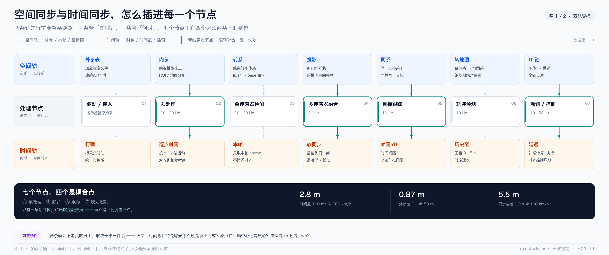

（2026-11 · 时空同步）空间同步与时间同步，是怎么插进每一个节点的

来源：起点是一个很常见的说法——"外参管空间对齐，时间戳管时间对齐"。这句话方向对，但把两件事说成了两个并列的开关。真实系统里，它们**在每一个节点上都各做一半，在四个节点上必须同时到位**。为了把"穿插"这件事画出来，做了两张图。

一句话：**空间同步和时间同步不是流水线上的两道工序，而是贯穿全链路的两条轨；所谓融合，就是在这两条轨的交汇点上，同时用法和同时算错。**

> 排版版：同目录 `2026-11-时空同步-双轨穿插与三个耦合点.pdf`（A4，8 页，含封面与页码）。
>
> 图在 `assets/` 下：
> - `2026-11-时空同步-图1-双轨穿插.png`
> - `2026-11-时空同步-图2-三个耦合点.png`
>
> 生成脚本：`assets/_make_spacetime_sync.py`（改数据重跑即可）

────────────────────────────

〇、两张图各回答什么

| # | 文件 | 回答的问题 | 一句话结论 |
|---|---|---|---|
| 1 | `2026-11-时空同步-图1-双轨穿插.png` | 这两件事到底在哪些环节发生 | 7 个节点，4 个是耦合点 |
| 2 | `2026-11-时空同步-图2-三个耦合点.png` | 耦合点里到底怎么"同时" | 不是两个步骤，是一次联合求解 |

────────────────────────────

一、图 1：双轨穿插 —— 七个节点，两条轨，四个交汇



图的结构很简单：**中间一行是处理节点，上面一行是"空间在这做了什么"，下面一行是"时间在这做了什么"**。青色竖线穿过的节点，就是两条轨必须同时到位的耦合点。

### 1. 为什么是"轨"不是"层"

如果按分层画，会是"空间对齐层 → 时间对齐层 → 融合层"，看起来像流水线。但实际代码里不是这样：

- 加载外参发生在**驱动/接入**；
- 内参用在**预处理**；
- 投影矩阵用在**融合**；
- tf 链一直活到**控制**。

时间同理：打戳在驱动，逐点时间在预处理，软同步在融合，延迟补偿在控制。

所以它是**一条从头贯到尾的轨**，只不过在每个节点上被"取用"了一次。把它画成层，会误导人去设计一个"统一对齐模块"——那个模块在工程上是不存在的。

### 2. 七个节点各自在做什么

| 节点 | 空间轨 | 时间轨 | 耦合 |
|---|---|---|---|
| ① 驱动 / 接入 | 加载标定文件、建静态 tf 树 | 标采集时刻、统一时钟域 | — |
| ② 预处理 | 畸变模型校正、ROI / 地面分割 | 按逐点时间戳补偿运动 | **是** |
| ③ 单传感器检测 | 结果转车体系 | 只取本帧 stamp | — |
| ④ 多传感器融合 | 投影 K[R\|t]、跨模态空间关联 | 软同步、插值到同一刻 | **是** |
| ⑤ 目标跟踪 | 同一坐标系下才谈得上"同一目标" | 帧间 dt、航迹外推门限 | **是** |
| ⑥ 轨迹预测 | 目标系 → 地图系 | 历史窗口、时序建模 | — |
| ⑦ 规划 / 控制 | 车体 → 世界，tf 链贯通 | 补偿计算与执行延迟 | **是** |

三个"没有耦合"的节点很有意思，它们说明了两种极端：

- **① 和 ③ 是"只搬不改"**：外参和 tf 在这一步只是被读进来，或者把结果换到一个更合适的系里。做错了会全错，但它本身不需要"同时"这个概念。
- **⑥ 是"时间主导"**：预测吃的是一段历史，空间只需要在开头把轨迹换到地图系一次，之后全程在时间轴上做文章。

### 3. 三个数决定了这件事有多贵

图 1 底部那三个数字，是我建议记住的量级——它们把"错一点"翻译成"错多少米"：

| 错在哪 | 条件 | 实际错位 |
|---|---|---|
| 时间差 100 ms | 100 km/h | **2.8 m** |
| 外参差 1° | 50 m 外 | **0.87 m** |
| 同步容差 0.2 s | 100 km/h | **5.5 m** |

车道宽是 3.5 m，半个车道是 1.75 m。**只要错位超过 1.75 m，目标就已经在隔壁车道了**——上面三个数里有两个直接越线。

这也顺带解释了一个反直觉的工程结论：**同步容差不是"调大一点更稳"，是"调大一点更危险"**。很多 ROS 工程里把 `ApproximateTime` 的容差调到 0.2 s 图省事，在 100 km/h 下这个"省事"价值 5.5 m。

### 4. 底部那条"前置条件"是整张图的暗线

图最低下那行字容易被当成脚注跳过，但它其实是前提：

> 两条轨能不能真的对上，取决于第三件事——**语义**。

时间戳标的是曝光中点还是读出完成？原点在后轴中心还是质心？单位是 m 还是 mm？

**语义错了，时间轨和空间轨会双双"看起来对齐了"，然后一致地错。** 这是最难查的一类问题，因为所有校验指标都正常。

────────────────────────────

二、图 2：三个耦合点 —— 不是两个步骤，是一次联合求解


图 1 标出了四个耦合点，图 2 把其中最能说明问题的三个拆开放大。每个面板的结构相同：**两路输入 → 汇聚 → 一次变换 → 一个输出**，下面接"缺一条会怎样"和"怎么验证"。

选这三个，是因为它们分别代表三种"耦合方式"：

### A · 去畸变（预处理）—— 逐点的耦合

- 空间输入：外参 `T_base←lidar`
- 时间输入：**逐点**时间戳 `t_i`
- 变换：运动补偿 undistort
- 输出：统一到 `t_ref` 的车体系点云

机械式激光雷达转一圈约 100 ms，转的过程中车在动。所以这一帧点云里，**每个点都是在不同的位姿下打出来的**。

要把它"拉正"，必须对每个点做一次 `T(t_i) · T_base←lidar`。注意这个式子里空间和时间是**乘在一起的**——没有"先算空间再算时间"的余地。

这就是为什么 Apollo 的点云格式里，每个点都带自己的时间戳：

```protobuf
message PointXYZIT {
  optional float  x = 1;
  optional uint64 timestamp = 5;   // 每个点一个时间
}
```

也是为什么 Autoware 的 `distortion_corrector` 要同时订阅 `~/input/twist` 和 `~/input/imu`——它需要每一个时刻的运动，才能把每一个点搬到同一个时刻。

**缺外参**：点云整体贴在错的位姿上，跟地图对不上，但看起来很"干净"。
**缺点时刻**：高速时点云沿运动方向被拉长，杆状物变成斜的——这个肉眼可辨。

### B · 融合关联（多传感器融合）—— 跨模态的耦合

- 空间输入：投影 `K[R|t]`
- 时间输入：软同步 + 插值
- 变换：关联 association
- 输出：同一物体、同一时刻的候选对

这里有个常被跳过的环节：**融合之前必须先"配对"**。

激光雷达的点是表面回波，相机的像素是辐亮度积分，毫米波雷达的检测是 cluster 质心加多普勒。**它们根本不是同一个物理量，严格讲无法"融合"，只能互相约束。**

所以第一步是回答："这个 lidar cluster 和那个 image bbox，是不是同一个东西？"

而这个判断，同时依赖空间（投影对不对）和时间（是不是同一刻）。

**缺空间**：框被投到隔壁车道，关联直接错。
**缺时间**：把相隔 0.2 s 的目标当成同一个，速度估计直接崩。

顺带说一句：`message_filters::ApproximateTime` 在这里有个结构性缺陷——**它要等所有 topic 都到齐才回调**。相机丢一帧，整帧感知就不输出了。Autoware 因此自己写了 `PrimeSynchronizer`：以激光雷达为主时钟，每帧必回调，找不到匹配的副主题就传 `nullptr` 进去。

**"允许某一路缺数据"本身就是一种设计决策**，它比"对齐精度"更影响可用性。

### C · 控制延迟补偿（规划 → 控制）—— 闭环的耦合

- 空间输入：车体 → 世界 tf
- 时间输入：计算 + 执行延迟 τ
- 变换：位姿外推 + 时间对齐
- 输出：在正确时刻生效的指令

这一条最容易被忽略，因为它在"感知"之外。

规划算出一条轨迹，从计算完成到方向盘真正转过去，中间有几十毫秒的延迟。这段时间里车又走了 1–2 m。

所以下发的不是"现在的指令"，而是"**在 τ 之后生效的指令**"——这需要把目标位姿沿轨迹外推到 `t + τ`，而这又需要世界系下的位姿（空间）和准确的 τ（时间）。

**缺空间**：方向打在错的路上。
**缺时间**：高速时车身画龙——经典的高速画龙，很多就是延迟没补偿。

### 三个面板的公共结论

> 它们都不是"先做完空间对齐，再做时间对齐"，而是在同一个函数里同时用上两套参数。

这句话是图 2 想说的全部。**"先空间后时间"在代码里落不了地**，因为变换矩阵本身就带时间参数 `T(t)`。

────────────────────────────

三、把两张图串起来读

先看图 1，建立一个"轨"的空间直觉：**两条轨平行贯穿，交汇处打了结**。
再看图 2，看那三个结里面到底是什么：**每个结都是一次 `T(t)` 的乘法**。

然后回到那句最容易被误读的总结：

> 融合的前提是：同一时刻 + 同一坐标系 + 同一语义，三者缺一不可。

按图去读，这三件事不是并列的三个开关，而是**递进的**：

```
语义（定义） → 时间（对齐到同一刻） → 空间（搬到同一个系） → 校验
```

理由很直接：**时间和空间都是"对齐操作"，而任何对齐操作都需要先知道"对齐的是什么"。** 时间戳的语义不定，插值就是在精确地对齐一个错误的时刻；坐标系原点不定，外参就是在精确地搬到错误的位置。

所以真正的判据只有一条：

> **不是"两个数能不能对上"，而是"这两组数描述的是不是同一个物体、在同一时刻、同一个物理量"。**

────────────────────────────

四、故障对照表：现象 → 先查哪条轨

这张表是这两张图最实用的产出。**同一个"目标飘了"，可能来自三条完全不同的轨。**

| 现象 | 先查 | 典型原因 |
|---|---|---|
| 高速时点云被沿运动方向拉长 | **时间** | 逐点时间戳缺失，或去畸变没用 IMU/twist |
| 目标在图像上投到隔壁车道 | **空间** | 外参标定漂移，或用了错的变换方向 |
| 静止时正常、一动就错 | **时间** | 时间戳是"接收时刻"而非"采集时刻" |
| 近距离正常、远处越来越偏 | **空间** | 角度误差被距离放大（1° @ 50 m = 0.87 m） |
| 目标朝向反了 180° | **语义** | 坐标系手性 / 朝向定义不一致 |
| 同一目标被计成两个 | **时间** | 同步窗口过大，或丢帧未标记 |
| 高速画龙、过冲 | **时间 + 空间** | 控制延迟未补偿 |
| 所有指标正常但行为诡异 | **语义** | 原点、单位、box 定义在链路某处被换过 |

最后一行值得单独记住：**前两条轨错了，你能在可视化里看见；语义错了，你看不见。**

────────────────────────────

五、两个量级表（可以直接拿去定指标）

**角度误差 × 距离**（`d = D · tanθ`，车道宽按 3.5 m 算）

| 角度误差 | 10 m | 30 m | 50 m | 100 m |
|---|---|---|---|---|
| 0.1° | 0.017 m | 0.052 m | 0.087 m | 0.175 m |
| 0.5° | 0.087 m | 0.26 m | 0.44 m | 0.87 m |
| 1° | 0.17 m | 0.52 m | **0.87 m** | 1.75 m |
| 2° | 0.35 m | 1.05 m | 1.75 m | 3.49 m |

读法：**想让 100 m 外的投影误差不超过半个车道（1.75 m），角度误差必须 ≤ 1°。** 这就是"远距离融合对标定精度极其苛刻"的量化解释。

**时间误差 × 车速**（`d = v · Δt`）

| 时间误差 | 30 km/h | 60 km/h | 100 km/h | 120 km/h |
|---|---|---|---|---|
| 10 ms | 0.08 m | 0.17 m | 0.28 m | 0.33 m |
| 50 ms | 0.42 m | 0.83 m | **1.39 m** | 1.67 m |
| 100 ms | 0.83 m | 1.67 m | **2.78 m** | 3.33 m |
| 200 ms | 1.67 m | 3.33 m | **5.56 m** | 6.67 m |

读法：**50 ms 在 100 km/h 下已经 1.39 m，接近半个车道。** 软同步的容差必须按车速定，不能给一个固定值。

────────────────────────────

六、落地检查清单

按两条轨逐条过，每条都能落到一个可执行动作上。

**空间轨**

- [ ] 打印 tf 链，确认每一级 `frame_id → child_frame_id` 的方向正确（外参文件命名和方向经常是反的）
- [ ] 确认变换链是**链式**的（传感器 → IMU → 车体 → 世界），而不是假设"传感器直接到车体"
- [ ] 确认原点定义全链一致（后轴中心 / 质心 / IMU，Apollo 用的是后轴中心）
- [ ] 地面点拟合平面，检查 pitch / roll 偏差
- [ ] 远处杆状物投影叠图，确认 1° 以内

**时间轨**

- [ ] 确认时间戳标的是**采集时刻**，不是接收时刻
- [ ] 确认所有 topic 在同一个时钟域（PTP / gPPS / 硬件触发）
- [ ] 确认点云有**逐点时间**，且去畸变真的用上了
- [ ] 检查时间戳单调性、抖动、回绕、丢帧标记
- [ ] 同步容差是否随车速自适应

**语义（两条轨的前置）**

- [ ] 时间戳指曝光中点 / 扫描中点 / 采样时刻——写进文档，全链一致
- [ ] 坐标系手性、轴向、单位，写进文档
- [ ] 3D box 用中心还是底中心，朝向怎么定义，训练和部署一致

────────────────────────────

七、一句话收尾

如果把这两张图压缩成一句：

> **空间同步在问"在哪"，时间同步在问"何时"，而耦合点在问"是不是同一个东西的同一刻"——第三个问题不回答，前两个问题的答案就没有意义。**

────────────────────────────

附：图的口径

- 图 1 的节点划分按通用自动驾驶感知栈（驱动 / 预处理 / 检测 / 融合 / 跟踪 / 预测 / 规划控制），频率取常见区间，不是某一家的实现。
- "4 个耦合点"的判据是：**该节点的核心运算里，变换矩阵带时间参数，或关联判据同时用到空间与时间**。按这个判据，③ 和 ⑥ 不算耦合（前者只做坐标搬运，后者只在开头搬一次）。
- 三个数字的算式见第五节。
- 代码实例（`header.proto` 的四个时间字段、`PrimeSynchronizer`、`distortion_corrector`）来自 UAV_Path_Planning_and_Autonomous_Driving 仓库的 Apollo / Autoware 源码，只作佐证，不影响图的结构。
