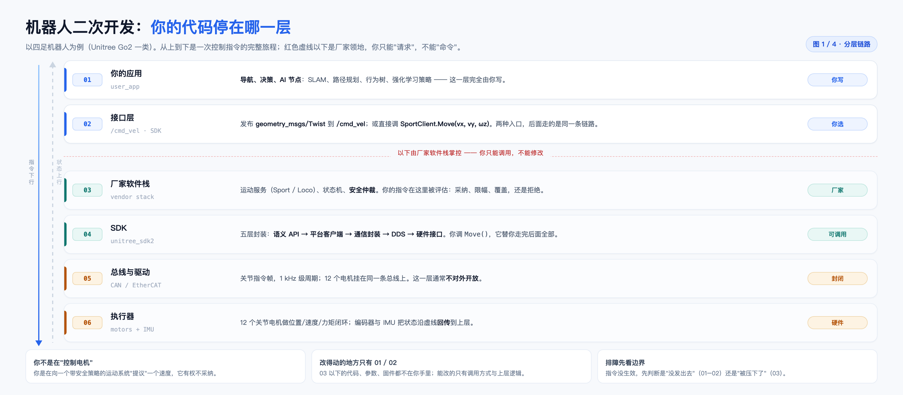
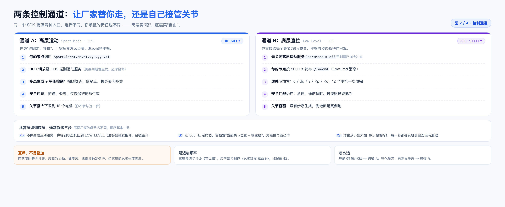
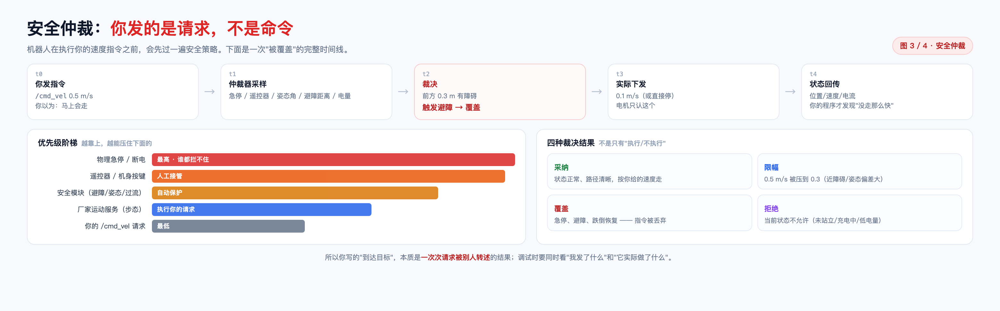
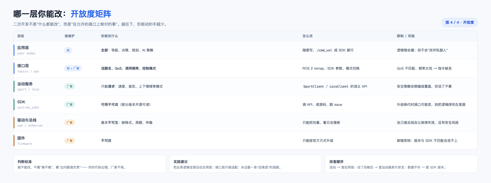
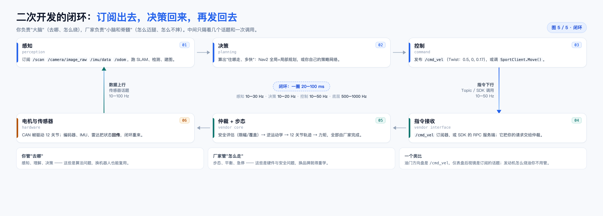

(2026-11 · 机器人) 二次开发读图说明：从分层到闭环（5 张图）

来源：围绕"买一台四足机器人做二次开发，我的代码到底能碰到哪里、发出去的指令会不会被执行"这一串问题，陆续画了五张图。这份文档逐张解释它们，并给出把五张串起来看的例子。

一句话：**你写的是"请求"，厂家做的是"裁决 + 执行"**；五张图分别回答"在哪一层""走哪条路""谁能否决""哪层能改""一圈怎么转"。

> 排版版：同目录 `2026-11-机器人二次开发.pdf`（A4，9 页）。图在本目录 `assets/` 下。

────────────────────────────

〇、五张图各回答什么（先看这张表）

| 图 | 文件 | 回答的问题 | 一句话结论 |
|---|---|---|---|
| 1 | `2026-11-机器人二次开发-图1-分层链路.png` | 我的代码停在哪一层 | 只有 01/02 两层能改，03 以下只能调用 |
| 2 | `2026-11-机器人二次开发-图2-两条通道.png` | 走高层还是底层 | 高层买"稳"，底层买"自由"，两者互斥 |
| 3 | `2026-11-机器人二次开发-图3-安全仲裁.png` | 我的指令会不会被执行 | 是"请求"，会被限幅、覆盖、拒绝 |
| 4 | `2026-11-机器人二次开发-图4-开放度矩阵.png` | 哪一层我能改 | 越往下越封闭，判断标准是"谁负责" |
| 5 | `2026-11-机器人二次开发-图5-闭环.png` | 一圈怎么转起来 | 感知→决策→控制→执行→回传，20–100 ms |

────────────────────────────

一、图 1：分层链路 —— 你的代码停在哪一层



六层自上而下：**你的应用 → 接口层 → 厂家软件栈 → SDK → 总线与驱动 → 执行器**。

红色虚线卡在第 2 层和第 3 层之间，这条线就是"你能改"和"你只能调"的分界：

- 01 应用层：导航、决策、AI 节点，完全由你写；
- 02 接口层：`/cmd_vel` 或 `SportClient.Move()`，你来选入口；
- 03 厂家软件栈：运动服务、状态机、**安全仲裁**，你的请求在这里被评估；
- 04 SDK：语义 API → 平台客户端 → 通信封装 → DDS → 硬件接口，五层全封装；
- 05 总线与驱动：CAN / EtherCAT 关节指令帧，通常不对外开放；
- 06 执行器：12 个关节电机 + IMU，状态沿虚线回传。

三个要点：

1. **改得动的只有 01 / 02**。03 以下的代码、参数、固件都不在你手里。
2. **排障先看边界**：指令没生效，先判断是"没发出去"（01–02）还是"被压下了"（03）。
3. **SDK 不是驱动**，它本身也是中间层 —— 你调 `Move()`，它替你走完 04 层内部全部。

────────────────────────────

二、图 2：两条通道 —— 让厂家替你走，还是自己接管关节



同一个 SDK 提供两种入口，选哪个决定了你承担多少责任。

**通道 A：高层运动（Sport Mode / RPC，10–50 Hz）**

- 你调 `SportClient.Move(vx, vy, ωz)`，语义就是"往哪走、多快"；
- 需要**周期性重发**，超时会停；
- 步态生成、落足点、机身姿态补偿都由厂家做；
- 安全仲裁仍然生效；
- 适合：导航、跟随、巡检。

**通道 B：底层直控（Low-Level / DDS，500–1000 Hz）**

- 必须先**关闭高层运动服务**（`SportMode = off`）；
- 按 500 Hz 发布 `/lowcmd`，逐关节填 `q / dq / τ / Kp / Kd`；
- 没有步态生成，平衡得自己算，倒地就是真倒地；
- 安全仲裁仍在：急停、通信超时、过流照样能截断；
- 适合：强化学习、自定义步态研究。

**两者互斥，不是叠加**：同时开会打架，表现为抖动、指令被覆盖，或直接触发保护。

从高层切到底层的三步（不同厂家函数名不同，顺序基本一致）：

1. 停掉高层运动服务，并等状态机回到 `LOW_LEVEL`（没等到就发指令，会被丢弃）；
2. 起 500 Hz 定时器，首帧发"当前关节位置 + 零速度"，先稳住再谈动作；
3. 增益从小到大加（Kp 慢慢抬），每一步都确认机身姿态没有发散。

────────────────────────────

三、图 3：安全仲裁 —— 你发的是请求，不是命令



图里画了一次"被覆盖"的完整时间线：

| 时刻 | 发生什么 | 说明 |
|---|---|---|
| t0 | 你发 `/cmd_vel` 0.5 m/s | 你以为马上会走 |
| t1 | 仲裁器采样 | 急停 / 遥控器 / 姿态角 / 避障距离 / 电量 |
| t2 | 裁决 | 前方 0.3 m 有障碍 → 触发避障 → 覆盖 |
| t3 | 实际下发 | 0.1 m/s，或直接停；电机只认这个 |
| t4 | 状态回传 | 你的程序才发现"没走那么快" |

**优先级阶梯（越上面越能压住下面的）**：

1. 物理急停 / 断电 —— 最高，谁都拦不住；
2. 遥控器 / 机身按键 —— 人工接管；
3. 安全模块（避障 / 姿态 / 过流）—— 自动保护；
4. 厂家运动服务（步态）—— 执行你的请求；
5. 你的 `/cmd_vel` 请求 —— 最低。

**四种裁决结果**，不是只有"执行 / 不执行"：

- **采纳**：状态正常、路径清晰，按你给的速度走；
- **限幅**：0.5 m/s 被压到 0.3（近障碍 / 姿态偏差大）；
- **覆盖**：急停、避障、跌倒恢复 —— 指令被丢弃；
- **拒绝**：当前状态不允许（未站立 / 充电中 / 低电量）。

所以调试时要同时看两样东西：**你发了什么**（`/cmd_vel`）和**它实际做了什么**（`/odom`、`/lowstate`）。

────────────────────────────

四、图 4：开放度矩阵 —— 哪一层你能改



| 层级 | 谁维护 | 你能改什么 | 限制 / 风险 |
|---|---|---|---|
| 应用层 | 你 | 全部逻辑 | 错了会撞，但不会"改坏机器人" |
| 接口层 | 你 + 厂家 | 话题名、QoS、频率、控制模式 | QoS 不匹配 / 频率太低 → 指令被丢 |
| 运动服务 | 厂家 | 只能"请求"速度、姿态、模式 | 安全策略会限幅或覆盖 |
| SDK | 厂家 | 可用不可改（部分开源可读） | 升级换代接口会变 |
| 驱动与总线 | 厂家 | 基本不可见 | 自己接总线会失保修 |
| 固件 | 厂家 | 不可改 | 刷错变砖，版本不匹配连不上 |

判断标准不是"难不难"，而是"**出问题谁负责**"—— 你的代码出错，厂家不背。

实践建议：业务逻辑全部压在应用层；接口层只做适配；永远留一条"回高层"的退路。

────────────────────────────

五、图 5：闭环 —— 一圈怎么转起来



```
        ① 感知 ──→ ② 决策 ──→ ③ 控制
          ↑                        │
   数据上行(10–100 Hz)      指令下行(10–50 Hz)
          │                        ↓
        ⑥ 硬件 ←── ⑤ 仲裁+步态 ←── ④ 指令接收
```

- ① 感知：订阅 `/scan`、`/camera/image_raw`、`/imu/data`、`/odom`；
- ② 决策：Nav2 全局+局部规划，或自己的策略网络；
- ③ 控制：发布 `/cmd_vel` 或调用 `SportClient.Move()`；
- ④ 指令接收：厂家的订阅器 / RPC 服务端；
- ⑤ 仲裁 + 步态：安全评估 → 逆运动学 → 12 关节轨迹；
- ⑥ 硬件：CAN 帧驱动电机，编码器 / IMU / 雷达把状态回传。

频率对照：感知 10–30 Hz、决策 10–20 Hz、控制 10–50 Hz、底层 500–1000 Hz，**一圈 20–100 ms**。

分工：你管"去哪"（算法问题，换机器人可复用），厂家管"怎么走"（硬件与安全问题，换品牌就得重学）。

────────────────────────────

六、把五张串起来：一次 30 秒的完整经历

| 时间 | 发生什么 | 对应哪张图 |
|---|---|---|
| 0.0 s | 上位机下发目标点（Action / 自定义接口） | 图 1 的 01 |
| 0.1 s | 规划器算出路径，开始发布 `/cmd_vel` 0.5 m/s | 图 5 的 ②③ |
| 0.5 s | 雷达在前方 0.8 m 发现行人 | 图 1 的 01 |
| 0.55 s | 仲裁器限速到 0.2 m/s | 图 3 的 t1–t3 |
| 0.6 s | 你的控制节点从 `/odom` 看到速度只有 0.2，但**不知道原因** | 图 3 的 t4 |
| 0.7 s | 局部规划器重新绕行 | 图 5 的 ② |
| 1.2 s | 恢复 0.5 m/s，回到闭环 | 图 5 |

结论：闭环里其实有**两套决策** —— 你的规划，和厂家的仲裁。搞不清"是谁改了我的速度"，就会在调参时反复怀疑自己的算法。

────────────────────────────

七、四个常见误区

1. **以为发了 `/cmd_vel` 就一定按这个速度走** —— 它只是请求，会被限幅或覆盖。
2. **以为 SDK 是"驱动"** —— 它也是中间层，真正的 CAN 帧你看不到。
3. **以为底层控制更"高级"** —— 它只是把责任转移给了你：摔了算你的。
4. **以为换品牌只要换话题名** —— 步态、安全策略、状态机完全不同，接口相似但行为不相似。

────────────────────────────

八、术语速查

| 词 | 在这里指什么 |
|---|---|
| DDS | 分布式发布订阅中间件，ROS 2 的通信底座 |
| RPC | 远程过程调用，高层运动服务用它"点一下、执行一次" |
| QoS | 话题的可靠性/队列策略；不匹配会收不到数据 |
| Sport Mode | 厂家封装的高层运动模式，管步态与平衡 |
| LowCmd | 底层控制消息，逐关节给位置/速度/力矩 |
| 仲裁 | 把多个控制源按优先级合成一个实际输出 |
| 逆运动学 | 从"脚落在哪"反解出"各关节转多少" |

────────────────────────────

九、附：文件与重出命令

| 文件 | 说明 |
|---|---|
| `assets/机器人-图1..图5-*.png` | 五张图，3120 宽（2× 高清） |
| `assets/_make_robot_note.html` | 本 PDF 的排版源文件（与本文档同名族） |
| `2026-11-机器人二次开发.pdf` | 排版后的 A4 版本 |

```bash
# 重出 PDF（在本笔记所在目录执行）
CHROME="/Applications/Google Chrome.app/Contents/MacOS/Google Chrome"
"$CHROME" --headless=new --disable-gpu --no-pdf-header-footer \
  --print-to-pdf="2026-11-机器人二次开发-读图说明.pdf" \
  "file://$PWD/assets/_make_robot_note.html"
```
