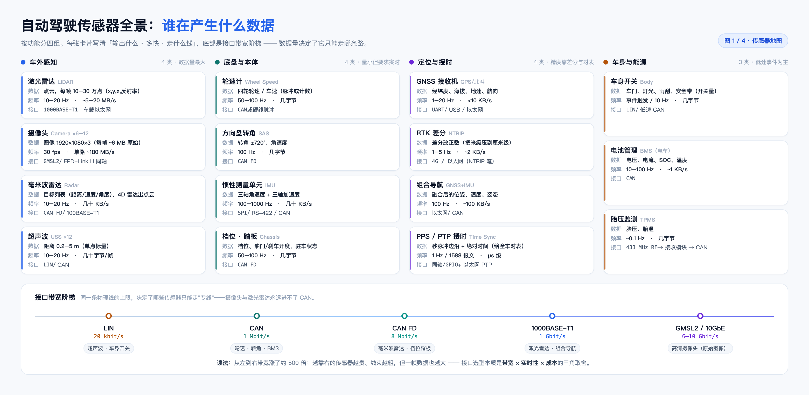
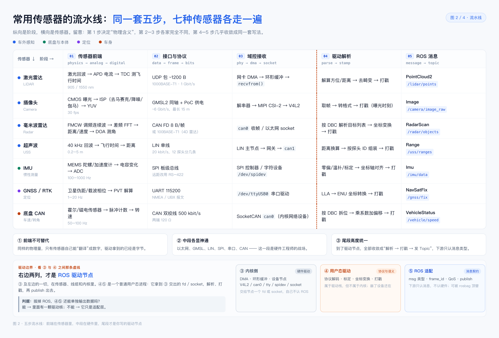
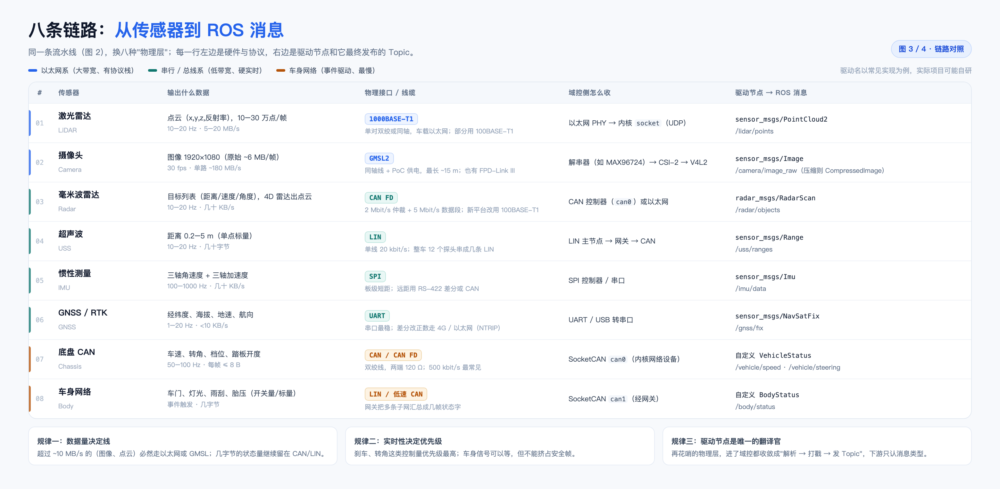
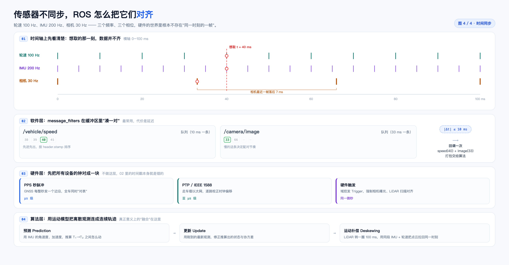

(2026-11 · 自动驾驶传感器链路) 读图说明：从物理量到一条 Topic（4 张图）

来源：从“传感器驱动到底解不解析数据、要不要一个中间节点统一监听”这一串问题出发，把一颗传感器从物理量走到 ROS topic 的全程画成了四张图。这份文档逐张解释它们，并给“驱动节点到底算不算硬件驱动”这个问法收口。

一句话：**一条传感器数据要走五步——前两步在传感器和线缆里，第三步在内核里，只有第四、五步是你写的驱动节点；它属于驱动栈，但不属于硬件驱动。**

> 排版版：同目录 `2026-11-自动驾驶-传感器链路-读图说明.pdf`（A4，9 页）。图在本目录 `assets/` 下。

────────────────────────────

〇、四张图各回答什么（先看这张表）

| # | 文件 | 回答的问题 | 一句话结论 |
|---|---|---|---|
| 1 | `assets/自动驾驶-传感器链路-图1-传感器全景.png` | 谁在产生什么数据 | 四类传感器，数据量差 500 倍，线路是被数据量选的 |
| 2 | `assets/自动驾驶-传感器链路-图2-五步流水线.png` | 一份数据经过谁的手 | 五步里只有 ④⑤ 是你的代码，③ 与 ④ 之间是内核边界 |
| 3 | `assets/自动驾驶-传感器链路-图3-八条链路.png` | 每颗传感器具体怎么接 | 八条链路，左边硬件与协议，右边驱动与 Topic |
| 4 | `assets/自动驾驶-传感器链路-图4-时间同步.png` | 不同步怎么对齐 | 打戳、凑对、对表、预测，四层缺一不可 |

四张图是一套：图 1 定“有哪些、多大量”，图 2 定“分几段、谁负责”，图 3 把图 2 的每一格落到具体硬件，图 4 处理图 2 尾段留下的时间问题。

────────────────────────────

一、图 1：传感器全景 —— 谁在产生什么数据



四类、十五张卡片：车外感知（激光、相机、毫米波、超声波）、底盘与本体（轮速、转角、IMU、档位踏板）、定位与授时（GNSS、RTK、组合导航、PPS/PTP）、车身与能源（车身开关、BMS、TPMS）。

每张卡只写三件事：**输出什么、多快、走什么线**。这是最省事的读法——先看“输出什么”判断能不能喂感知，再看“多快”判断要不要同步，最后看“走什么线”判断谁采谁。

底部那条带宽阶梯是全图的落点：

```
LIN 20 kbit/s → CAN 1 Mbit/s → CAN FD 8 Mbit/s → 1000BASE-T1 1 Gbit/s → GMSL2 6–10 Gbit/s
超声波/车身开关   轮速/转角      毫米波/档位        激光/组合导航          高清相机原始图像
```

**从左到右差约 500 倍**。这不是“接口越新越好”，而是：摄像头单路 ~180 MB/s、激光点云 ~5–20 MB/s，这种量级只有以太网 / GMSL 接得住；几十字节的状态量留在 CAN / LIN 上最便宜、也最稳。

三个要点：

1. **数据量决定线路，不是反过来。** 接口选型本质是“带宽 × 实时性 × 成本”的三角取舍，图上的阶梯就是取舍的结果。
2. **频率决定“谁等谁”。** IMU 100–1000 Hz、轮速 50–100 Hz、相机 30 Hz、GNSS 1–20 Hz——它们不可能天然同拍，图 4 就是为这件事画的。
3. **组合导航是“硬件里已经融合过一次”的传感器。** GNSS + IMU 在模组内部就做了组合，ROS 侧只看到一个 `NavSatFix` 加一个 `Imu`，你看不见里面合了几路。这也解释了为什么“传感器数量”不能直接当冗余度用。

一个提醒：别用“装了几颗”衡量感知覆盖，用“带宽 × 频率 × 冗余”。

────────────────────────────

二、图 2：五步流水线 —— 同一条链，七颗传感器各走一遍



五步是：**前端 → 接口 → 域控接收 → 驱动解析 → ROS 消息**。纵向是阶段，横向是传感器。第 1 步决定物理含义，第 2–3 步各家完全不同，第 4–5 步几乎收敛成同一套写法。

图上三句图注已经把话说完了：

- **① 前端不可替代**：驱动拿到的已经是字节，物理量的“翻译”只能发生在传感器里；
- **② 中段各显神通**：以太网、GMSL、LIN、SPI、串口、CAN，这一段由硬件决定，是硬件工程师的战场；
- **③ 尾段高度统一**：进入驱动节点后，全部收敛成“解析 → 打戳 → 发 Topic”，下游只认消息类型。

### 这次更新加的那条虚线和那条带子

图里 ③ 与 ④ 之间画了一条橘色虚线，底部加了一条“驱动边界”带——它们标的是整张图最重要的一条边界：

```
① 传感器前端  ② 接口与协议  ③ 域控接收  ┊  ④ 驱动解析   ⑤ ROS 消息
   传感器内部     线缆 / 收发器   内核 / OS  ┊   用户态           用户态
                                            ┊
                                    syscall 边界
```

| 列 | 实际归属 | 典型形态 | 换它要动谁 |
|---|---|---|---|
| ① 传感器前端 | 传感器固件 + 模拟前端 | APD/TDC、CMOS+ISP、MEMS+ADC | 换传感器 |
| ② 接口与协议 | 物理层 / 链路层 | GMSL2、CAN、LIN、SPI、UART、以太网 | 换线束 / 收发器 |
| ③ 域控接收 | **内核驱动 + 协议栈 + 设备节点** | V4L2、SocketCAN、tty、spidev、socket | 内核 / 驱动模块 |
| ④ 驱动解析 | **用户态驱动** | 解包、标定、坐标变换、打戳 | 换 SDK / 改节点 |
| ⑤ ROS 消息 | **适配层** | msg 类型、`frame_id`、QoS、publish | 换消息类型 |

所以：**ROS 驱动节点 = ④ + ⑤**。它站在 ③ 交给它的 fd 上干活，第一行代码就是 `open()` 或 `socket()`：

```
open("/dev/video0")  /  ioctl(VIDIOC_DQBUF)     ← ③ 的出口：拿到 fd
recvfrom(sock)  /  read(can_fd)  /  read(spi_fd)
──────────────────────── syscall 边界 ────────────────────────
parse(buf) → points | image | frame             ← ④
stamp = driver_time                             ← ④
publish(topic, msg)                             ← ⑤
```

### 那它到底算不算硬件驱动的一部分？

**广义：算。** 它是驱动栈的用户态那半截，干的是协议解析、设备状态机、错误恢复、打时间戳这些“驱动该干的活”。Linux 本来就有用户态驱动的传统（`i2c-dev`、`spidev`、`libusb`、UIO）——内核只给字节流，私有协议只能由用户态接管。

**严格：不算。** 它不持有设备、不在特权层、能在容器里跑、能被 `rosbag play` 顶替。这四条都是“应用”的特征，不是“驱动”的特征。

判据一句：**把 ROS 拔掉，它还能单独跑、还能把数据吐出来吗？**

- 能 → 里面有一颗驱动核（例如 livox SDK、librealsense），ROS 节点只是外壳；
- 不能 → 它是“驱动 + 适配”揉在一起，别把它当纯应用，也别把它当纯驱动。

工程上的建议：复杂传感器拆成 `driver_core`（不依赖 ROS 的库，可单测）+ `ros_node`（薄壳：参数、msg 转换、QoS、生命周期）。**这样“算不算驱动”就不再是语义争论：core 是驱动，node 是适配层。**

### ④ 里哪些能挪走、哪些不能

- **必须留在 ④**：协议解析、打戳。挪走就丢了原始时间基准和 frame 语义，图 4 的配对全部失准。
- **可以挪到下游**：坐标变换（传感器 → 车体）、LLA → ENU。很多栈把这两步放到 TF / 转换节点，驱动只发原始测量。
- **不该进 ④**：融合、感知、跟踪。驱动只翻译，不理解。

这一点也解释了图 2 里为什么“雷达”和“GNSS”两格写着坐标变换：那是常见写法，不是唯一写法。

────────────────────────────

三、图 3：八条链路 —— 左边硬件与协议，右边驱动与 Topic



八条依次是：激光雷达、摄像头、毫米波雷达、超声波、IMU、GNSS/RTK、底盘 CAN、车身网络。

三条规律：

1. **数据量决定线。** 超过 ~10 MB/s 的图像、点云必然走以太网或 GMSL；几字节的状态量继续留在 CAN / LIN。
2. **实时性决定优先级。** 刹车、转角这类控制量优先级最高；车身信号可以等，但不能挤占安全帧。
3. **驱动节点是唯一的翻译官。** 再花哨的物理层，进了域控都收敛成“解析 → 打戳 → 发 Topic”。

读法：左边三列（输出什么 / 物理接口 / 域控怎么收）是硬件工程师的战场，右边一列（驱动节点 → ROS 消息）是软件接入点。注意“域控怎么收”就是图 2 的 ③ 列——两图是同一件事的两种切法：图 2 按阶段切，图 3 按传感器切。

────────────────────────────

四、图 4：时间同步 —— 三个频率、三个相位，怎么凑成同一帧



轮速 100 Hz、IMU 200 Hz、相机 30 Hz。想取 t = 40 ms 那一刻，相机最近一帧落后 7 ms——**“同一时刻”在硬件世界里根本不存在**。

四层，从上到下：

1. **时间轴上先看清**：三条频率不同、相位不同的采样序列，以及“想取的那刻”落在哪里。
2. **软件层**：`message_filters` 在缓冲区里“凑一对”，`|Δt| ≤ 10 ms`；慢的那条决定配对节奏，代价是延迟。
3. **硬件层**：PPS 秒脉冲（μs 级）、PTP / IEEE 1588（亚 μs 级）、硬件触发（同一微秒）。不做这层，第 2 层的时间戳本身就是错的。
4. **算法层**：预测（用 IMU 推算 T1→T2 怎么动）、更新（用最新观测修正状态与协方差）、运动补偿 deskew（LiDAR 转一圈 100 ms，用同段 IMU + 轮速把点云拉回同一时刻）。

三个要点：

1. **打戳必须发生在 ④。** 挪到订阅端，就等于用“收到的时间”冒充“采样的时间”，后面所有同步都是在错误基准上做算术。
2. **`message_filters` 只能“凑”，不能“造”。** 差 7 ms 可以近似，差 70 ms 就只能靠算法预测。
3. **时钟源要统一。** 同一个 bag 里混用 `CLOCK_REALTIME` 和 `CLOCK_MONOTONIC`，是排查同步问题最常见的坑。

────────────────────────────

五、把四张图串起来读

一条主线：

- **图 1** 说“有哪些传感器、各自吐多少数据”；
- **图 2** 说“数据从物理量到 topic 分五段，哪一段是你写的”；
- **图 3** 说“八条具体链路的硬件与驱动怎么对应”；
- **图 4** 说“多颗传感器的时间怎么对齐”。

如果只记一句：**驱动只做翻译，不做理解；同步不在总线上，在订阅端和算法层。**

三个常见误解：

1. **“驱动就是厂商 SDK / 内核 .ko”。** 图 2 的 ③ 才是内核，④–⑤ 是用户态进程；SDK 只是 ④ 可能引用的库。
2. **“有一个中间节点统一监听所有传感器”。** 没有。每颗传感器一个驱动节点，中间是 topic 不是节点；真正存在的“中间层”只有管理框架（启停、配置、健康检查）和转发工具（relay、rosbag、bridge），它们都不解析。
3. **“融合应该放进驱动”。** 融合需要多源和时间对齐，属于下游；塞进驱动，等于把可替换的边界变成单点。

────────────────────────────

六、附：文件与重出

| 文件 | 说明 |
|---|---|
| `assets/自动驾驶-传感器链路-图1-传感器全景.png` | 图 1，四类传感器全景，3120×1524 |
| `assets/自动驾驶-传感器链路-图2-五步流水线.png` | 图 2，五步流水线 + 驱动边界，3120×2117（本次更新） |
| `assets/自动驾驶-传感器链路-图3-八条链路.png` | 图 3，八条链路对照，3120×1528 |
| `assets/自动驾驶-传感器链路-图4-时间同步.png` | 图 4，时间同步四层，3120×1624 |
| `assets/_make_sensor_chain_fig2.html` | 图 2 的源文件（HTML，Chrome 无头截图出图） |
| `assets/_render_fig2.sh` | 图 2 的一键重出脚本（截图 + 裁边） |
| `assets/_make_sensor_chain_note.html` | 本笔记 PDF 版的排版源文件 |
| `2026-11-自动驾驶-传感器链路-读图说明.pdf` | 排版后的 A4 版本（9 页） |

改图 2 的文案 / 配色后重出：

```bash
cd 笔记/三维视觉/assets
./_render_fig2.sh            # 依赖 Chrome 与 Pillow，输出覆盖图 2 的 PNG
```

只改 PDF 排版后重出 PDF：

```bash
cd 笔记/三维视觉
CHROME="/Applications/Google Chrome.app/Contents/MacOS/Google Chrome"
"$CHROME" --headless --disable-gpu --no-sandbox --no-pdf-header-footer \
  --print-to-pdf="2026-11-自动驾驶-传感器链路-读图说明.pdf" \
  "file://$PWD/assets/_make_sensor_chain_note.html"
```

> 图 1 / 3 / 4 沿用同批产出的原图，本次未改动；图 2 的旧版（3120×1324，无驱动边界带）已被覆盖。若不想要那条带子，删掉 `_make_sensor_chain_fig2.html` 里的 `.band` 块和 `.cutcol` 的虚线，重跑脚本即可得到无带版本。
