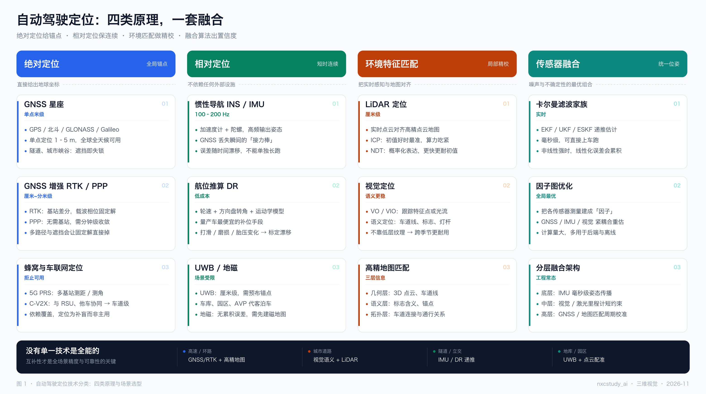
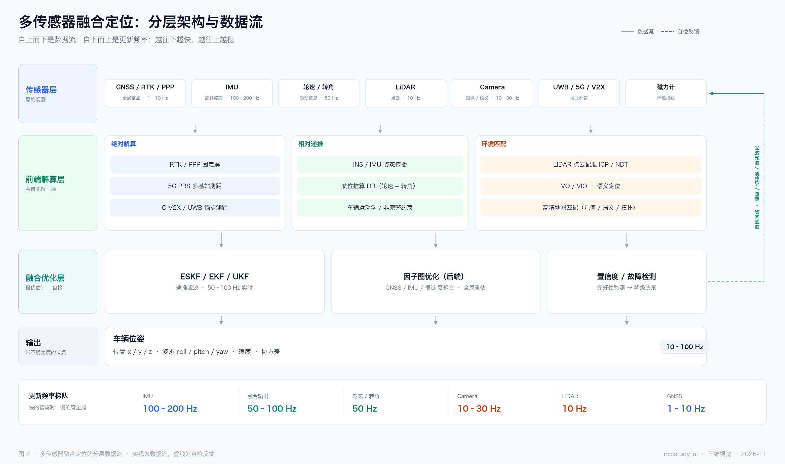
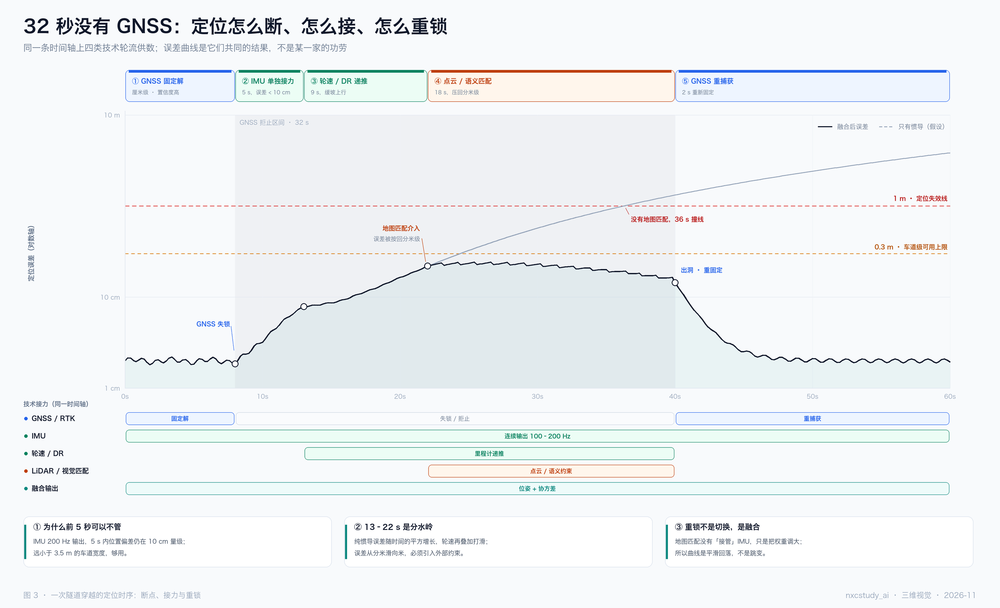
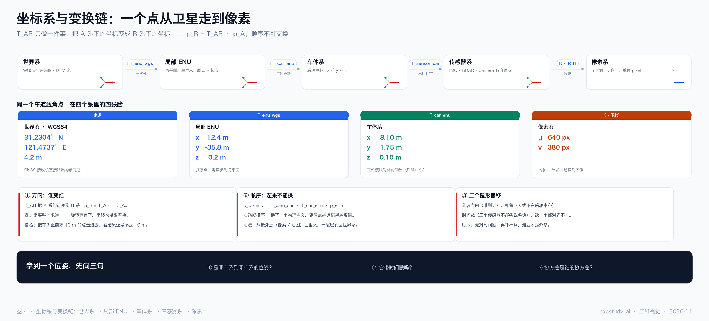
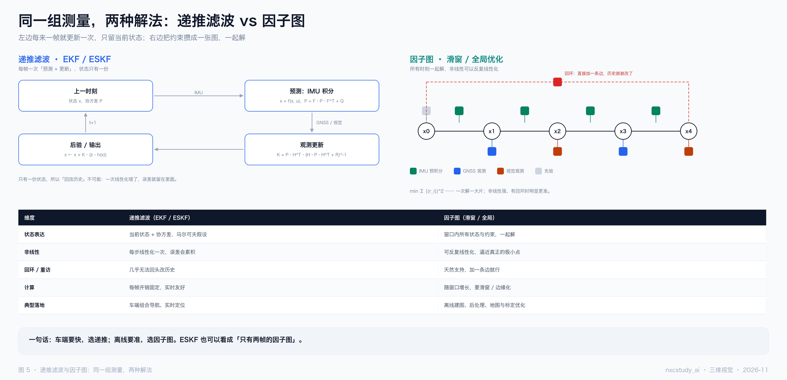
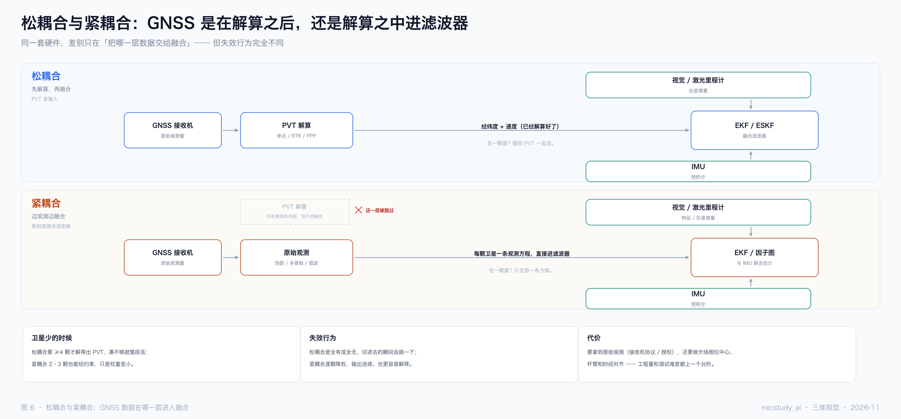
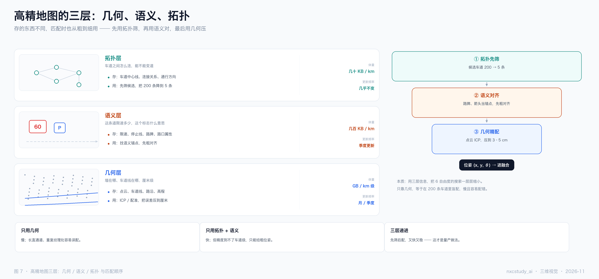
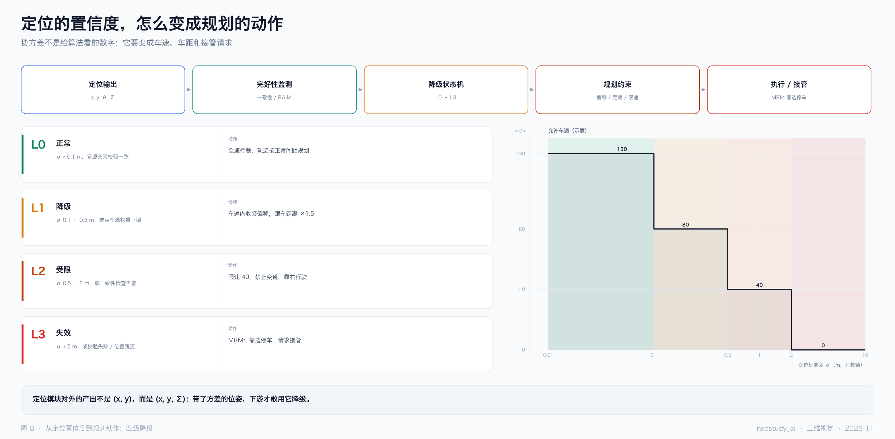
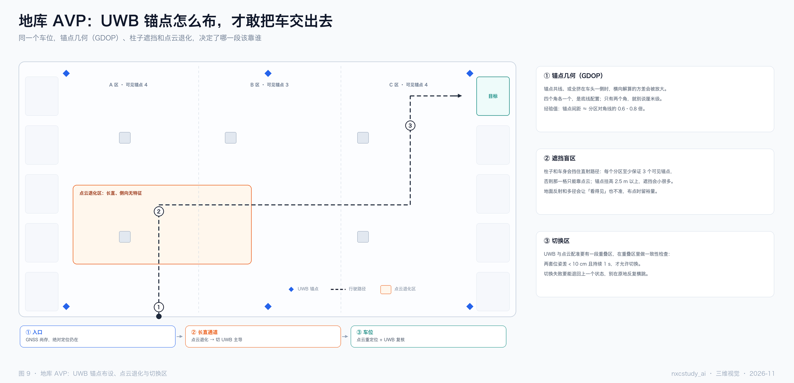

(2026-11 · 自动驾驶定位) 读图说明：从技术全景到一次隧道穿越（9 张图）

来源：围绕"自动驾驶的定位模块到底由哪些技术组成、它们怎么排班、失效时会发生什么"这一串问题，先后画了九张图。这份文档逐张解释它们，并给出把九张串起来读的顺序。

一句话：**定位不是一个模块，是一套排班表**——绝对定位给锚点，相对定位保连续，环境匹配做精校，融合算法把它们拧成一个**带方差的位姿**。九张图分别回答"有哪些手段""怎么组织""时间上是什么样"，以及四张放大镜和两张落地图。

> 排版版：同目录 `2026-11-自动驾驶定位-读图说明.pdf`（A4，13 页）。图在本目录 `assets/` 下。

────────────────────────────

〇、九张图各回答什么（先看这张表）

| # | 文件 | 回答的问题 | 一句话结论 |
|---|---|---|---|
| 1 | `2026-11-自动驾驶定位-图1-技术全景.png` | 定位到底有哪些技术 | 四类信息来源，各自都有天花板 |
| 2 | `2026-11-自动驾驶定位-图2-分层架构.png` | 这些技术怎么组织 | 四层数据流 + 一条自检回路 |
| 3 | `2026-11-自动驾驶定位-图3-隧道时序.png` | 断掉的时候会发生什么 | 32 秒里四次接力，误差被按在 0.3 m 以下 |
| 4 | `2026-11-自动驾驶定位-图4-坐标系变换链.png` | 位姿到底在哪个系 | 五个系、四次变换，顺序不可交换 |
| 5 | `2026-11-自动驾驶定位-图5-递推与因子图.png` | 融合算法有哪两种范式 | 递推求快，因子图求准 |
| 6 | `2026-11-自动驾驶定位-图6-松紧耦合.png` | GNSS 在哪一层进来 | 解算之后进来叫松，解算之中进来叫紧 |
| 7 | `2026-11-自动驾驶定位-图7-地图三层.png` | 高精地图匹配用的是什么 | 拓扑筛、语义对、几何压 |
| 8 | `2026-11-自动驾驶定位-图8-置信度降级.png` | 置信度往下游怎么用 | 协方差要变成车速、车距和接管 |
| 9 | `2026-11-自动驾驶定位-图9-地库AVP.png` | 没有 GNSS 的地库怎么办 | UWB 的精度由锚点几何决定 |

────────────────────────────

一、图 1：技术全景 —— 四类原理，一张图排开



这四类不是"四种方案备选"，是四种**信息来源**：绝对定位给你地球坐标，相对定位给你自身运动，环境匹配给你局部校正，融合负责把它们拧成一个带置信度的位姿。

每列三张卡，读法都一样：**是什么 → 能做到多少 → 卡在哪**。第三行永远是"卡在哪"，因为定位选型本质上不是选"谁更准"，而是选"你能接受哪种失效"。

三个要点：

1. **精度不是一个数，是一个前提**。RTK 的厘米级前提是"固定解"，固定解的前提是"看得见天"。条件一破，精度是断崖式归零，不是缓慢下降。
2. **相对定位的敌人是时间**。IMU 和轮速在 3 秒内很准，30 秒后就没法看——图 3 会把这条曲线画出来。
3. **底部的场景条是全图的落点**：高速靠 GNSS + 高精地图，城市靠视觉语义 + LiDAR，隧道靠 IMU / DR，地库靠 UWB + 点云配准。同一条路，四段路四个主角。

────────────────────────────

二、图 2：分层架构 —— 从上到下是数据流，从下到上是频率



四层：**传感器 → 前端解算 → 融合优化 → 输出**。注意前端解算层被拆成了三支（绝对 / 相对 / 环境），这三支正是图 1 四类里去掉"融合"之后剩下的三个。

三个要点：

1. **右侧那条虚线是自检回路**。置信度和故障检测不只是"输出一个数"，它会反向触发降级、切换源、重初始化——这是它和普通输出的区别。
2. **底部的频率梯队是"为什么要分层"的答案**：IMU 200 Hz、相机 30 Hz、GNSS 5 Hz。快的管短时，慢的管全局，中间必须有东西把它们对齐。
3. **层与层之间传递的不是数字，是"带不确定度的数字"**。少了协方差，上一层就没法判断该信多少。

────────────────────────────

三、图 3：隧道时序 —— 32 秒里，误差曲线是怎么被按住的



这张图有两条曲线：黑实线是**融合后**的误差，灰虚线是**假设第 22 秒没有地图匹配**。两条线在第 22 秒分岔——那就是全图的转折点。

五个相位依次是：GNSS 固定解（0–8 s）→ IMU 单独接力（8–13 s）→ 轮速 / DR 递推（13–22 s）→ 点云 / 语义匹配介入（22–40 s）→ GNSS 重捕获（40–60 s）。

三个要点：

1. **两条阈值线给"能用"下了定义**：0.3 m 是车道级可用上限，1 m 是定位失效线。黑线一次都没碰到 0.3，灰线在第 36 秒撞上 1 m。
2. **误差不是线性涨的**。纯惯导的误差随时间平方增长，所以前 5 秒可以不管，十几秒之后就开始难看了——这就是图上"13–22 s 是分水岭"那句话的来源。
3. **重锁不是切换，是融合**。曲线在 40 秒陡降，但不是某个模块"接管"了，而是匹配帧把累积误差一次性拉回。所以它平滑回落，不是跳变。

────────────────────────────

四、图 4：坐标系与变换链 —— 一个点从卫星走到像素



五个系：**世界系 → 局部 ENU → 车体系 → 传感器系 → 像素系**。四个箭头就是四次变换，每个都标了"谁给的这个变换"：一次性、每帧更新、出厂标定、内参。

中间那排是"同一个车道线角点在四个系里的四张脸"。数值是编的，但量级是对的：经纬度 → 米 → 米 → 像素。

三个要点：

1. **方向**：`T_AB` 把 A 系的点变到 B 系（`p_B = T_AB · p_A`）。反过来要整体求逆——旋转转置了，平移也得跟着换。
2. **顺序**：`p_pix = K · T_cam_car · T_car_enu · p_enu`。从最外层往内乘，一层层剥回世界系；换序就等于换了一个物理含义。
3. **三个隐形偏移**：外参方向、杆臂（GNSS 天线不在后轴中心）、时间戳。图纸上画不出来的，往往就是上车后对不齐的。

底部黑条是自检三问：**这是哪个系到哪个系的位姿？它带时间戳吗？协方差是谁的？**

────────────────────────────

五、图 5：EKF 与因子图 —— 同一组测量，两种解法



左边是个**环**：预测 → 更新 → 输出 → 下一帧。只有一份状态，所以"回改历史"不可能，一次线性化错了，误差就留在里面。

右边是张**图**：圆形节点是状态，方块是约束（IMU 预积分、GNSS、视觉、先验），回环就是加一条边——历史就被改了。

三个要点：

1. **差别不在精度，在"能不能反悔"**。递推每帧算完就翻篇；因子图把所有约束攒着，一起解。
2. **非线性强的时候，因子图的优势才显出来**，因为它可以反复线性化，逼近真正的极小点。
3. **典型落地见表格最后一行**：车端实时选递推（EKF / ESKF），离线建图、后处理、标定优化选因子图。ESKF 也可以看成"只有两帧的因子图"。

────────────────────────────

六、图 6：松耦合与紧耦合 —— GNSS 在哪一层进滤波器



两幅图长得几乎一样，差别只有一处：交给滤波器的到底是**经纬度**，还是**伪距 / 多普勒 / 载波**。

三个要点：

1. **松耦合的 PVT 是个黑盒**：≥4 颗星才解得出，解不出就整段丢——"全有或全无"。
2. **紧耦合把解算搬进滤波器**：2–3 颗星也能贡献约束，逐颗降权，输出连续，也更容易解释。
3. **代价是要拿原始观测**（接收机协议 / 授权），还要做天线相位中心、杆臂和时间对齐。工程量和调试难度都上一个台阶——图里那个被打叉的"PVT 解算"框，说的就是"这一层被跳过了"。

────────────────────────────

七、图 7：高精地图三层 —— 几何、语义、拓扑



三层不是"三个文件"，是三种抽象级别：**拓扑管连通，语义管含义，几何管位置**。

三个要点：

1. **体量差三个数量级**：拓扑几十 KB/km，语义几百 KB/km，几何 GB/km 级。这也决定了它们的更新频率：拓扑几乎不变，语义季度更新，几何按月。
2. **匹配是从粗到细**：先用拓扑把 200 条候选车道筛到 5 条，再用语义（路牌、箭头）找锚点粗对齐，最后用几何（点云 ICP、车道线）压到 3–5 cm。
3. **只用一层都不行**：只靠几何，等于在 200 条车道里盲配，慢且容易配错；只靠拓扑 + 语义，快但精度到不了车道级。

────────────────────────────

八、图 8：置信度怎么变成动作



定位对外的产出不是 `(x, y)`，是 `(x, y, Σ)`。上面那条流水线说明它去哪：定位输出 → 完好性监测 → 降级状态机 → 规划约束 → 执行 / 接管。

三个要点：

1. **四级降级有明确的判据**：L0 正常（σ < 0.1 m）→ L1 降级（0.1–0.5 m，收紧车道内偏移、跟车距离 ×1.5）→ L2 受限（0.5–2 m，限速 40、禁止变道、靠右）→ L3 失效（> 2 m，MRM 靠边停车、请求接管）。
2. **右侧阶梯图是"允许车速 vs σ"（示意）**：协方差每上一个台阶，规划就少一分自由。这张图的数值不用记，形状要记住——它是阶梯，不是斜坡。
3. **判据不只靠 σ**，还要靠"多源一致性"和"位置跳变检测"。单看方差，会被一次平滑的错误估计骗过去。

────────────────────────────

九、图 9：地库 AVP 的 UWB 布点



地库里没有 GNSS，靠 UWB + 点云。但 UWB 的精度**完全由锚点几何决定**（GDOP）——同一批硬件，布点不同，精度能差一个量级。

三个要点：

1. **锚点共线、或全挤在车头一侧时，横向解算的方差会被放大**。四个角各一个，是底线配置；只有两个角，就别谈厘米级。
2. **柱子和车身会挡住直射路径**：每个分区至少保证 3 个可见锚点，否则那一格只能靠点云；锚点挂高 2.5 m 以上，遮挡会小很多。
3. **切换区要有一段重叠**：UWB 与点云配准的结果在重叠区里做一致性检查，两套位姿差 < 10 cm 且持续 1 s，才允许切换，切的时候别停。

图上的 A / B / C 三个分区标了"可见锚点 4 / 3 / 4"，这就是布点的验收标准：不是"有没有信号"，而是"每个分区够不够解算"。

────────────────────────────

十、把九张图串起来读

一条主线：

- **图 1** 说"有哪些手段"——四类信息来源，各自的失效方式不同；
- **图 2** 说"怎么组织"——四层数据流，加一条自检回路；
- **图 3** 说"组织起来在时间上是什么样"——断、接、重锁的 32 秒；
- **图 4–7** 是四张放大镜：坐标系（位姿在哪个系）、滤波器（怎么解）、耦合方式（数据在哪一层进来）、地图（拿什么对齐）；
- **图 8–9** 是两张落地图：往下游怎么降级，地库里锚点怎么布。

如果只记一句：**定位的产出是带方差的位姿，不是坐标。** 少了那个 Σ，后面所有的降级、限速、接管都无从谈起。

────────────────────────────

十一、画这九张图时守的三条规矩（也是读图时的三个检查点）

1. **别把"融合"画成并列的第五类技术**。它是横向的：图 1 里它单独一列，是因为它不产生观测，只组合观测。图 2 里它是第三层，位置在"解算之后、输出之前"。
2. **隧道图里误差不能画成直线**。纵轴是**对数**的，横轴才是线性时间；纯惯导误差按时间的平方增长，画成直线就把"前 5 秒不用管、十几秒开始难看"这个节奏丢了。
3. **松耦合与紧耦合不是两条并行链路**。硬件、传感器、滤波器全一样，唯一变量是"交给滤波器的是解算结果还是原始观测"。两幅图的框子位置故意画成一样，就是为了让这个变量显眼。

────────────────────────────

十二、附：图片与可编辑源文件

| 文件 | 说明 |
|---|---|
| `assets/2026-11-自动驾驶定位-图1-技术全景.png` | 图 1，技术全景，3120×1742，2× 高清 |
| `assets/2026-11-自动驾驶定位-图2-分层架构.png` | 图 2，分层架构，3120×1846 |
| `assets/2026-11-自动驾驶定位-图3-隧道时序.png` | 图 3，隧道时序，3120×1898 |
| `assets/2026-11-自动驾驶定位-图4-坐标系变换链.png` | 图 4，坐标系与变换链，3120×1417 |
| `assets/2026-11-自动驾驶定位-图5-递推与因子图.png` | 图 5，EKF vs 因子图，3120×1508 |
| `assets/2026-11-自动驾驶定位-图6-松紧耦合.png` | 图 6，松耦合 vs 紧耦合，3120×1456 |
| `assets/2026-11-自动驾驶定位-图7-地图三层.png` | 图 7，高精地图三层，3120×1456 |
| `assets/2026-11-自动驾驶定位-图8-置信度降级.png` | 图 8，置信度到下游，3120×1534 |
| `assets/2026-11-自动驾驶定位-图9-地库AVP.png` | 图 9，地库 AVP 布点，3120×1508 |
| `assets/_make_localization.py` | 九张图的源文件（纯 Pillow 直绘，无浏览器依赖） |
| `assets/_make_loc_note.html` | 本笔记 PDF 版的排版源文件 |
| `2026-11-自动驾驶定位-读图说明.pdf` | 排版后的 A4 版本（13 页） |

改文案 / 配色后重出九张图：

```bash
cd "assets"   # 在本笔记所在目录执行，且已安装 Pillow
python3 _make_localization.py .     # 覆盖输出九张 PNG
```

只重出某一张（改脚本最后改成单独调用即可）：

```bash
python3 -c "
import importlib.util
spec = importlib.util.spec_from_file_location('m', '_make_localization.py')
m = importlib.util.module_from_spec(spec); spec.loader.exec_module(m)
m.fig3('assets/2026-11-自动驾驶定位-图3-隧道时序.png')
"
```

排版版 PDF 重出（改了 `assets/_make_loc_note.html` 之后）：

```bash
CHROME="/Applications/Google Chrome.app/Contents/MacOS/Google Chrome"
"$CHROME" --headless=new --disable-gpu --no-pdf-header-footer \
  --print-to-pdf="2026-11-自动驾驶定位-读图说明.pdf" \
  "file://$PWD/assets/_make_loc_note.html"
```
