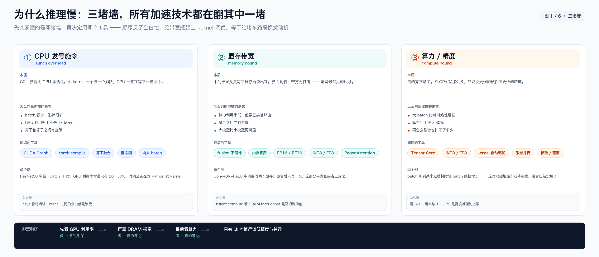
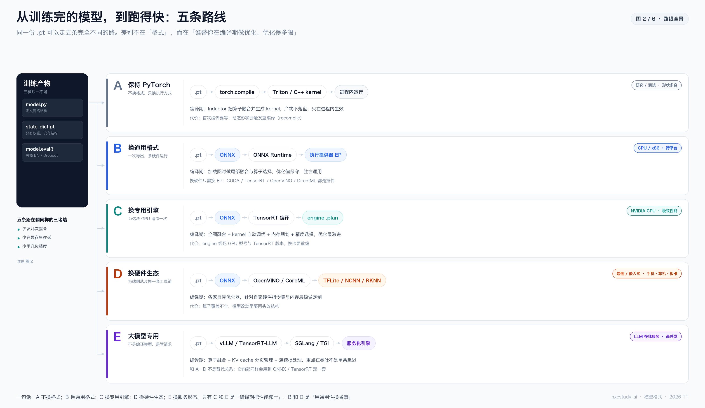
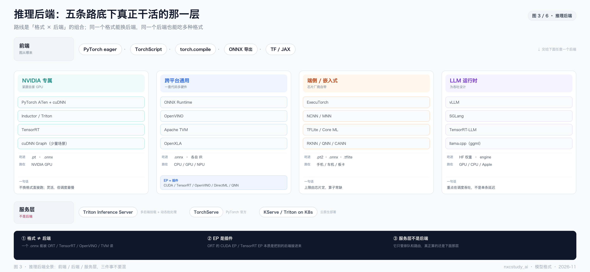
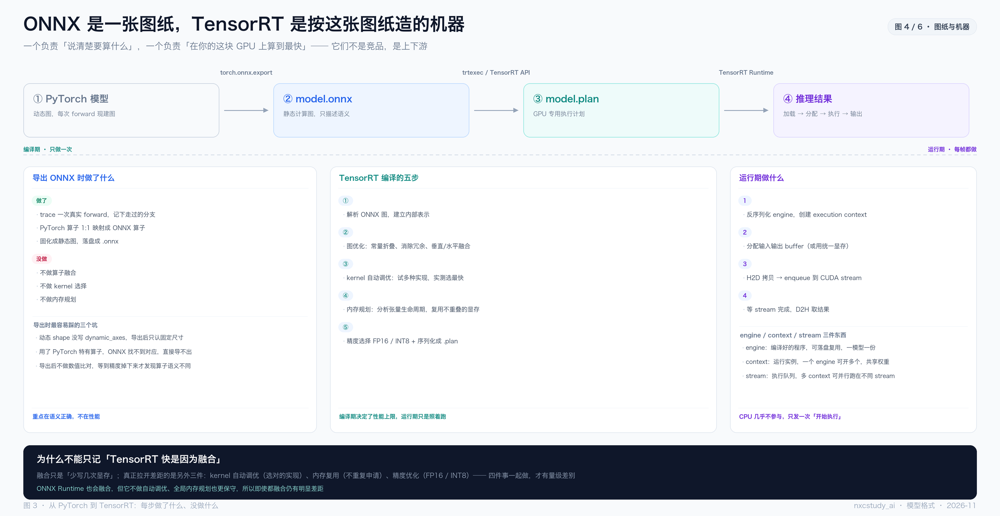
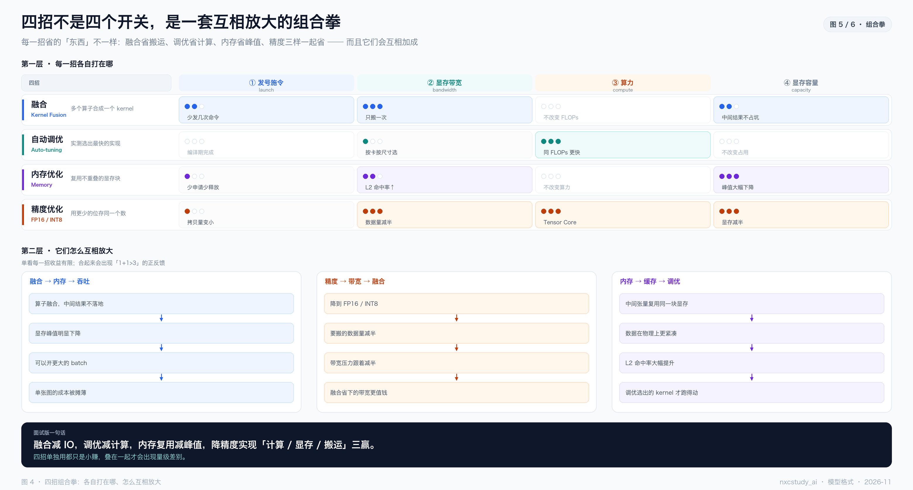
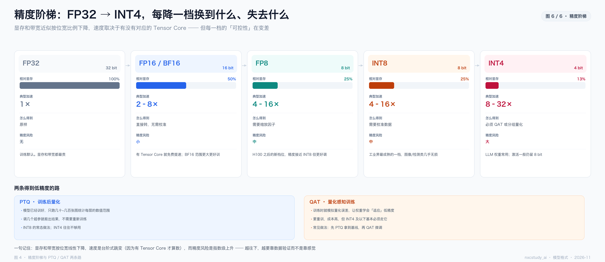

（2026-11 · 模型格式）推理加速：把所有技术路线重新理一遍

来源：从《2026-06-ONNX与TensorRT推理加速》那条笔记出发，把散落在 ONNX、TensorRT、torch.compile、CUDA Graph、量化、vLLM 里的东西，重新按"**它到底在解决什么问题**"排一次序。写给刚开始接触部署的人看。

一句话：**推理加速没有十几种技术，只有三堵墙和五条路。** 三堵墙是"CPU 发号施令太慢、显存来回搬、算力真的不够"；五条路是"不换格式 / 换通用格式 / 换专用引擎 / 换硬件生态 / 换服务形态"。所有名词都能挂到这两张骨架上。

> 排版版：同目录 `2026-11-推理加速技术路线全景.pdf`（A4，10 页，含封面与页码）。
>
> 六张图在 `assets/` 下（与本文同名，仅以 `-图N-标题` 区分）：
> - `2026-11-推理加速技术路线全景-图1-三堵墙.png`
> - `2026-11-推理加速技术路线全景-图2-路线全景.png`
> - `2026-11-推理加速技术路线全景-图3-推理后端全景.png`
> - `2026-11-推理加速技术路线全景-图4-ONNX与TensorRT.png`
> - `2026-11-推理加速技术路线全景-图5-四招组合拳.png`
> - `2026-11-推理加速技术路线全景-图6-精度阶梯.png`
>
> 生成脚本：`assets/_make_infer_roadmap.py`（改数据重跑即可）

────────────────────────────

〇、先把四个词分清楚

新手最先卡住的不是技术，是**名词混用**。这四组如果不分开，后面全是雾。

| 词 | 是什么 | 不是什么 |
|---|---|---|
| **格式**（.pt / .onnx / .plan / .rknn） | 一个**文件**，描述"要算什么" | 不是引擎，自己不跑 |
| **引擎**（Runtime） | 一个**程序**，负责真的把算完 | 不是编译器，多数不做深度优化 |
| **编译器**（TensorRT / Inductor / TVM） | 一个**离线工具**，把图变成针对硬件的机器码 | 不是运行时，跑起来是另一段代码 |
| **精度**（FP32 / FP16 / INT8） | 数字用几位存 | 不是"压缩算法"，是表示方式 |

**四者的关系**：编译器吃格式、吐格式；运行时吃格式、吐结果。

```
 训练产物           格式              编译器               最终格式           运行时
 .pt  ──导出──▶  .onnx  ──编译──▶  TensorRT  ──序列化──▶  .plan  ──加载──▶  Runtime
```

**最容易犯的错**：以为"换成 ONNX 就快了"。**不会。** 换格式只是让下游的优化器有机会介入，它自己不产生任何加速。

────────────────────────────

一、为什么慢：三堵墙



所有加速技术，本质上都在翻这三堵墙之一。**先诊断再开药**，否则就是给带宽瓶颈做 kernel 调优——等于给堵车路段换发动机。

### 墙 ① CPU 发号施令太慢（launch overhead）

GPU 算一个 kernel 要几微秒，但 CPU 每发一条命令也要几微秒。当 kernel 本身很小（激活函数、逐元素加法），**GPU 大部分时间在等下一条命令**。

- 症状：batch=1、GPU 利用率 20–30%、nsys 时间轴上一段一段的空白
- 翻墙工具：CUDA Graph、torch.compile、算子融合、静态图、增大 batch
- 怎么量：`nsys` 看 kernel 之间的间隙

### 墙 ② 显存带宽（memory bound）—— 最常见的那个

GPU 算得比喂得快。每个中间结果都要写回显存再读出来，带宽先被打满。

- 症状：算力利用率低但 DRAM 带宽接近峰值；一融合立刻变快
- 翻墙工具：fusion（中间结果不落地）、内存复用、FP16/BF16、INT8/FP8、PagedAttention
- 怎么量：`nsight compute` 看 DRAM throughput

> 这条墙最反直觉：**算力越强的卡，越容易被带宽卡住**。所以"换更贵的 GPU"经常不如"把三个算子融成一个"。

### 墙 ③ 算力真的不够（compute bound）

FLOPs 就那么多，只能换硬件或降精度。

- 症状：batch 增大后耗时线性增长；算力利用率 > 80%
- 翻墙工具：Tensor Core、INT8/FP8、kernel 自动调优、张量并行、稀疏/蒸馏
- 怎么量：看 SM 占用率与 TFLOPS 是否接近理论上限

### 判断顺序（很重要）

```
先看 GPU 利用率 ──低──▶ 撞的是 ①
      │
      高
      ▼
再量 DRAM 带宽 ──满──▶ 撞的是 ②
      │
      没满
      ▼
最后看算力 ──满──▶ 撞的是 ③
```

**只有确认撞的是 ③，才值得谈低精度和并行。** 顺序反了，你会在 ① 的问题上花三天做量化，然后发现一点没变快。

────────────────────────────

二、五条路线



同一份 `.pt`（结构 + state_dict + eval 模式），可以走五条完全不同的路。**差别不在格式，在"谁替你在编译期做优化、做得多狠"。**

| 路线 | 做什么 | 产物 | **推理后端** | 适合谁 | 代价 |
|---|---|---|---|---|---|
| **A 保持 PyTorch** | 只换执行方式，`torch.compile` | 进程内产物，不落盘 | PyTorch 原生 ATen + cuDNN / Inductor | 研究、调试、形状多变 | 首次编译慢；动态形状会重编译 |
| **B 换通用格式** | 导出 ONNX，交给 ORT | `model.onnx` | ONNX Runtime（+ EP 插件） | CPU / x86 / 多硬件 | 优化保守，多半只能拿到一部分收益 |
| **C 换专用引擎** | ONNX → TensorRT 编译 | `model.plan` | TensorRT | NVIDIA GPU、追极致延迟 | engine 绑死 GPU 型号与 TRT 版本 |
| **D 换硬件生态** | 各家 SDK | `.rknn` / `.mlmodel` / `.tflite` | RKNN / CoreML / TFLite / NCNN / MNN | 手机、车机、开发板 | 算子覆盖不全，常要改模型结构 |
| **E 大模型专用** | vLLM / TRT-LLM / SGLang | 服务化引擎 | vLLM / SGLang / TensorRT-LLM | LLM 在线服务、高并发 | 面向吞吐，不是单条延迟 |

### 逐条说清楚

**A · torch.compile** —— 一句话：**不换格式，只换"执行方式"**。

`torch.compile` 内部是两段：Dynamo 负责把 Python 的动态执行"抓"成一张静态图，Inductor 负责把这张图编译成 Triton 或 C++ kernel。它做的是融合、消除中间张量、减少 Python 调用。产物活在进程里，不落盘。

代价：第一次调用要等编译；输入形状一变可能触发重编译（recompile），所以"形状天天变"的模型反而不适合。

**B · ONNX Runtime** —— 一句话：**一次导出，多硬件运行**。

ONNX Runtime 用"执行提供器（EP）"的插件机制接不同后端：CUDA EP、TensorRT EP、OpenVINO EP、DirectML EP、QNN EP……换硬件只换 EP，模型不用动。这是它最大的价值。

代价：**优化偏保守**。它在加载图时做局部融合与算子选择，但没有 TensorRT 那种全局视角和自动调优。

**C · TensorRT** —— 一句话：**为这块 GPU 编译一次，跑到极限**。

它把整个图当整体：全图融合、kernel 自动调优、全局内存规划、精度选择。产物是 `engine`（`.plan`），本质是**一段为当前 GPU 和当前 TRT 版本生成的机器码**。

代价很硬：**engine 不可移植**。换 GPU 型号要重编，升级 TRT 版本要重编，动态 shape 要提前声明 profile。

**D · 端侧生态** —— 一句话：**为端侧芯片换一套工具链**。

OpenVINO（Intel）、CoreML（Apple）、TFLite（Android）、NCNN/MNN（移动端推理框架）、RKNN（瑞芯微）、昇腾 CANN…… 每家都有自己的量化工具和算子集。

代价：**算子覆盖不全**。你模型里随便一个自定义算子，在端侧可能就没有实现，得回头改结构或拆图。

**E · LLM 服务化** —— 一句话：**不是编译一个模型，是管理一批请求**。

vLLM（PagedAttention + 连续批处理）、TensorRT-LLM（in-flight batching）、SGLang（RadixAttention 前缀缓存）。它们关注的指标不是单条延迟，而是**吞吐（tokens/s per GPU）**。

注意：**E 和其他四条不是替代关系**。TensorRT-LLM 内部同样会做 ONNX/TRT 那一套；vLLM 的 kernel 也是编译好的 CUDA。E 是在 D 之上再加"调度层"。

### 推理后端：真正干活的那一层

上面那张表的「产物」只是**格式**；真正把 kernel 跑起来的是**后端**。把后端补齐，路线才完整：

| 路线 | 后端 | 谁做的 | 一句话特点 |
|---|---|---|---|
| A | PyTorch ATen + cuDNN / Inductor | Meta | 不换格式，最灵活，调度开销也最大 |
| B | ONNX Runtime（EP 插件） | 微软 | 换 EP 就换硬件，优化偏保守 |
| C | TensorRT | NVIDIA | 编译期榨干，绑死硬件 |
| D | RKNN / CoreML / TFLite / NCNN / MNN | 各家芯片厂 | 为自家芯片定制，算子常缺 |
| E | vLLM / SGLang / TensorRT-LLM | 各家 | 为吞吐设计，自带调度层 |



#### 后端不止这五个

图 3 把它们按生态分成四族。**记住「四族」比背名字有用**：

| 族 | 代表 | 什么时候用 |
|---|---|---|
| **NVIDIA 专属** | PyTorch ATen + cuDNN、Inductor / Triton、TensorRT | 手里只有 N 卡，要把延迟压到底 |
| **跨平台通用** | ONNX Runtime、OpenVINO、Apache TVM、OpenXLA | 一套代码跑 CPU / GPU / NPU，或 Intel 平台 |
| **端侧 / 嵌入式** | ExecuTorch、NCNN / MNN、TFLite / Core ML、RKNN / QNN / CANN | 手机、车机、开发板 |
| **LLM 运行时** | vLLM、SGLang、TensorRT-LLM、llama.cpp | 在线服务，关心吞吐而不是单条延迟 |

#### 三个不要混的概念

**① 格式 ≠ 后端。** 一个 `.onnx` 能被 ORT、TensorRT、OpenVINO、TVM 同时读。所以「用了 ONNX」完全不能说明快慢——**要看它被谁读**。

**② EP 是插件。** ONNX Runtime 的「执行提供器（Execution Provider）」本质是把别的后端接进来：CUDA EP 走 cuDNN，TensorRT EP 直接调 TRT，OpenVINO EP 调 Intel，DirectML 走 Windows，QNN 走高通 NPU。**换 EP 就换硬件，模型一行不用改**——这是 ORT 最大的价值。

**③ 服务层不是后端。** Triton Inference Server、TorchServe、KServe 负责排队、路由、动态批处理，真正算的还是下面那层。这两个词经常混着说，但职责完全不同：**后端决定「多快」，服务层决定「同时服务多少个」。**

#### 一句话选后端

- 只有 NVIDIA 卡、追延迟 → **TensorRT**
- 要跨硬件、含 CPU → **ONNX Runtime**
- Intel CPU / iGPU → **OpenVINO**
- 手机 / 车机 / 板卡 → **芯片厂商 SDK**
- LLM 高并发 → **vLLM**，追极致上 **TensorRT-LLM**
- 只是想让训练脚本快一点 → **torch.compile**，别上别的

────────────────────────────

三、ONNX：六个必须纠正的认知

这一节基本来自原笔记的"冲突"部分，我按重要性重排了。

**① ONNX 不是推理引擎，是中间表示（IR）**

它是一张**有向无环图**：节点是算子（Conv、MatMul、Add），边是 tensor。文件本质是 protobuf。

它能做的只有一件事：**跨框架交换**。PyTorch 训练 → ONNX → TensorRT / ORT / OpenVINO 推理。

**② 导出 ONNX 时，几乎不做任何优化**

`torch.onnx.export` 做的事：
- trace 一次真实 forward，记下走过的分支
- PyTorch 算子 **1:1 映射**成 ONNX 算子
- 固化成静态图，落盘

**它不做**：算子融合、kernel 选择、内存规划。

**导出器的目标是语义正确，不是性能。** 指望"导出一下变快"是常见的空等。

**③ ONNX Runtime ≠ ONNX**

- ONNX = 一个**文件格式**
- ONNX Runtime = 一个**执行引擎**，能读 ONNX 并做一定优化

把两者混为一谈，会导致"为什么我用了 ONNX 还是没变快"这种困惑——因为你只是换了格式，还没接引擎。

**④ 即使两者都做 fusion，ORT 也没 TensorRT 快**

差的不是融合，是三件事：**kernel 自动调优**、**全局内存规划**、**精度优化**。ORT 走 cuDNN/cuBLAS 的通用路径，TensorRT 走 NVIDIA 自家针对每代 GPU 调过的路径。

**⑤ TensorRT 快，不只是因为融合**

这是原笔记里最重要的一条。见下一节。

**⑥ 顺序不能反**

```
先让模型在 PyTorch 里跑对
   → 再导出 ONNX 并做数值比对
      → 最后才上 TensorRT 调优
```

**跳过第二步直接上 TRT，你会花一周时间 debug 一个本来在 ONNX 层就错的算子映射。**

────────────────────────────

四、TensorRT 到底做了什么



原笔记那句话我完全同意，值得抄下来：

> **TensorRT 快不是单一原因，而是融合（减 IO）+ 自动调优（选最优 kernel）+ 内存优化（复用 + 不落地）+ 精度优化（FP16/INT8）的四重组合拳。**

### 四招各自省什么



| 招 | 省的是 | 打在哪 | 一句话 |
|---|---|---|---|
| **融合** | 搬运（IO） | ② 带宽 | 多个算子合成一个 kernel，**只搬一次**，算完一气呵成 |
| **自动调优** | 计算 | ③ 算力 | 同一算子有无数种实现，实测选出**最快**的那个 |
| **内存优化** | 峰值显存 + L2 命中 | ④ 容量 / ② 带宽 | 生命周期不重叠的中间张量**共用一块** |
| **精度优化** | 计算 + 显存 + 搬运 | ②③④ **全中** | 位宽减半，**三样一起省** |

> 表里多出来的「④ 显存容量」不是第四堵「速度墙」——它不让你变慢，它让你**直接跑不起来**（OOM）。但在工程里，它经常比速度更早成为约束，所以单独列一列。

注意最后一行的形状：**前三招各打一个点，精度一打就是三个。** 这就是为什么量化经常是性价比最高的一步——它同时命中带宽、算力、容量三处，而其他三招各打一处。

### 降精度的"三重暴击"

FP32 → FP16 不是"缩小文件"这么简单，它同时改了三件事：

```
① 算得快  ── Tensor Core 对 FP16 的吞吐是 FP32 的 2–8 倍
② 省显存  ── 32 位变 16 位，显存直接减半，能塞下更大的模型
③ 搬得快  ── 要搬的字节数减半，同样的带宽，搬运时间直接减半
```

三项叠加，正好覆盖三堵墙里的两堵（②带宽、③算力）加一个容量（④显存）。

**这也解释了为什么"降精度"经常是单点收益最大的一招：它同时打三处，而其他三招各打一处。**

### 组合拳：四招怎么互相放大

单独看每一招，收益经常只有 10–20%；**叠起来才会出现量级差别**。有三条正反馈在起作用：

**反馈 1 · 融合 → 内存 → 吞吐**

```
算子融合，中间结果不落地 → 显存峰值明显下降 → 可以开更大的 batch → 单张图的成本被摊薄
```

**反馈 2 · 精度 → 带宽 → 融合**

```
降到 FP16 / INT8 → 要搬的数据量减半 → 带宽压力跟着减半 → 融合省下的那部分带宽「相对更值钱」
```

**反馈 3 · 内存 → 缓存 → 调优**

```
中间张量复用同一块显存 → 数据在物理上更紧凑 → L2 命中率大幅提升 → 调优选出的 kernel 才真的跑得动
```

反过来看更清楚：

- **没有内存优化**，融合了的算子也可能因为显存不够而频繁换入换出
- **没有精度优化**，调优再好也会被庞大的数据搬运量拖住

所以"四招"不是四个可以单独勾选的开关，而是**一套互相放大的组合**。你只上其中一招，很可能感觉不到变化；四招齐上，才会出现"这部机器怎么突然这么快"的落差。

> **面试版一句话**：融合减 IO，调优减计算，内存复用减峰值，降精度实现「计算 / 显存 / 搬运」三赢。

### 为什么"自动调优"是秘密武器

同一个卷积，在 A100 和 T4 上、在 H=224 和 H=512 时，**最快的实现不是同一个**。

- PyTorch 是 JIT 执行，运行时才决定，没法提前全局搜索
- cuDNN 的 heuristic 是"快速但粗糙"的猜测
- **TensorRT 在编译期把候选实现都跑一遍 micro-benchmark，选实测最快的**

这件事**手写代码做不到**——你不可能为每个 shape × 每张卡手写一份最优实现。

类比：PyTorch 是到饭馆看着菜单点；TensorRT 是把菜单上所有菜都尝一遍再点。

### 编译期 vs 运行期

| 阶段 | 做什么 | 频率 |
|---|---|---|
| **编译期**（TensorRT 编译） | 解析 → 图优化 → kernel 选择 → 内存规划 → 序列化 | **一次** |
| **运行期**（Runtime） | 反序列化 → 建 context → 分配 buffer → enqueue → 取结果 | **每帧** |

**关键认知**：**性能上限在编译期就定了，运行期只是照着跑。** 所以"推理慢"这个问题，八成要在编译阶段解决，而不是在运行时代码里加优化。

### engine / context / stream

三个容易混的东西：

- **engine**：编译好的程序，可落盘复用，**一个模型一份**
- **context**：engine 的运行实例，**一个 engine 可以开多个**，共享权重
- **stream**：CUDA 执行队列，多个 context 可以跑在不同 stream 上并行

多路视频流推理时，通常就是"一个 engine + 多个 context + 多个 stream"。

────────────────────────────

五、精度路线



| 档位 | 位宽 | 相对显存 | 典型加速 | 怎么得到 | 风险 |
|---|---|---|---|---|---|
| FP32 | 32 | 100% | 1× | 原样 | 无 |
| FP16 / BF16 | 16 | 50% | 2–8× | 直接转 | 小 |
| FP8 | 8 | 25% | 4–16× | 缩放因子 | 中 |
| INT8 | 8 | 25% | 4–16× | 校准数据 | 中 |
| INT4 | 4 | 13% | 8–32× | QAT 或分组量化 | 大 |

**两个关键点：**

1. **显存和带宽是按位宽线性下降的，但速度是台阶式跳变的** —— 因为必须有对应的 Tensor Core 才算数。没有 FP8 硬件的老卡，FP8 只会更慢（要模拟）。
2. **精度风险是指数级上升的。** FP16 几乎无损；INT8 在图像/检测类上通常掉不到 1 个点；INT4 基本必须靠 QAT 或分组量化，且一般只压权重，激活仍留 8 bit。

### PTQ 与 QAT

| | PTQ（训练后量化） | QAT（量化感知训练） |
|---|---|---|
| 做法 | 模型训好后，跑几十~几百张图统计每层范围 | 训练时就模拟量化误差 |
| 成本 | 低，调几个超参 | 高，要重训 |
| 适用 | INT8 的常态做法 | INT4 及以下基本必须 |
| 推荐路径 | 先 PTQ 拿基线 | 掉点明显再 QAT 微调 |

### 一条容易忽略的：按需反量化

INT8 模型存的是 int8 权重 + scale。**推理时不是"提前把整层反量化好"，而是算到第 L 层才反量化第 L 层，算完丢弃。**

```
推理到第 L 层 → 只反量化第 L 层 → 算完丢掉 → 下一层再反量化
```

如果提前全反量化，float 权重会膨胀 4 倍，**省显存的意义就没了**。

────────────────────────────

六、运行时与调度这条路（最容易被忽略）

前面五条都在"编译期"做文章。但还有一类技术，动的是**运行期怎么发命令、怎么排队**。

| 技术 | 在做什么 | 翻哪堵墙 | 限制 |
|---|---|---|---|
| **CUDA Graph** | 把一串 kernel 启动"录"下来，之后一键重放 | ① | 必须静态形状、无动态分支 |
| **Continuous Batching** | 请求不等整批做完，完成的就走、新的就进 | ③ | 需要调度器支持 |
| **PagedAttention** | KV cache 按页分配，像虚拟内存一样 | ② | LLM 专用 |
| **前缀缓存** | 相同 prompt 前缀的 KV 复用 | ② | 需要识别公共前缀 |
| **异步流水** | 前处理 / 推理 / 后处理重叠 | ① | 实现复杂度高 |

**CUDA Graph 值得单独说**，因为它经常被当成"TensorRT 的一部分"——其实不是，它是 TensorRT 的**可选插件**。

```
普通 Eager：发指令 → 等 → 发指令 → 等 ……（重复 N 次）
CUDA Graph：录制一次所有 kernel 启动 → 回放 N 次，CPU 不介入
```

`s = torch.cuda.CUDAGraph()` 录制、`g.replay()` 回放。`torch.compile(mode="reduce-overhead")` 内部就会自动用它。

**限制很硬**：输入形状固定、不能有 if/else 分支、第一次要预热录制。

────────────────────────────

七、并行这条路

前面都是"一张卡上怎么更快"。如果一张卡装不下，或者算力就是不够，才轮到并行。

| 方式 | 切什么 | 适合 | 代价 |
|---|---|---|---|
| **数据并行** | 切 batch | 训练 | 推理一般不用 |
| **张量并行** | 切单层内的矩阵 | 单层太大装不下 | 通信量极大，要 NVLink |
| **流水并行** | 切层 | 层数极多 | 有气泡，吞吐受影响 |
| **MoE** | 切专家 | 大模型稀疏化 | 路由与负载均衡复杂 |

**判断标准很简单**：能用一张卡 + 量化解决的，别上并行。并行的通信开销经常吃掉一半收益。

关于 KV cache 与动态并行的冲突（"计算可以无状态路由，但 KV cache 是有状态的"），已经有专门一篇：`2026-09-动态模型并行与KV缓存冲突.md`。

────────────────────────────

八、我该选哪条？（决策树）

```
模型还在改 / 还在调结构
  └─▶ 用 A：torch.compile，别急着上 TensorRT
        （engine 每次改模型都要重编，迭代期不划算）

已经定版，部署在 NVIDIA GPU，追求低延迟
  └─▶ 用 C：ONNX → TensorRT
        先跑通 FP16，掉点可接受就停；不够再上 INT8 + 校准

部署在 CPU / x86 服务器
  └─▶ 用 B：ONNX Runtime（CPU EP）或 OpenVINO
        先确认算子都被支持，再谈量化

部署在手机 / 车机 / 开发板
  └─▶ 用 D：先看芯片厂商给什么 SDK
        常见坑是算子不支持，先做算子清单核对

LLM 在线服务，关心吞吐
  └─▶ 用 E：vLLM 起步，追极致上 TensorRT-LLM
        先量清楚是 prefill 慢还是 decode 慢

只是想训练/调试时快一点
  └─▶ 用 A：torch.compile，一行搞定
```

**一条经验**：**先做"能跑通"，再做"更快"。** 大部分团队卡在第一步（算子不支持、数值对不上），而不是第二步。

────────────────────────────

九、十二个常见误区

| # | 误区 | 实际 |
|---|---|---|
| 1 | ONNX 是推理引擎 | 它只是图格式，不执行 |
| 2 | 导出 ONNX 会自动优化 | 1:1 映射，只保语义正确 |
| 3 | TensorRT 快是因为融合 | 融合只是一项，还有调优/内存/精度 |
| 4 | ONNX Runtime 和 TensorRT 差不多 | 缺自动调优与全局内存规划，差距明显 |
| 5 | FP16 一定更快 | 没有 Tensor Core 或不是瓶颈时，可能没变化 |
| 6 | INT8 一定掉很多点 | 图像/检测类通常 < 1 个点，要实测 |
| 7 | engine 可以跨卡复用 | 绑死 GPU 型号 + TRT 版本，换卡重编 |
| 8 | CUDA Graph 万能 | 必须静态形状，动态分支录不了 |
| 9 | batch 越大越好 | 用延迟换吞吐，实时场景要克制 |
| 10 | 融合越多越好 | 过度融合可能挡住并行、影响数值 |
| 11 | 量化完不用验证 | 必须跑评测集比对，否则是赌博 |
| 12 | 加速就是"换个格式" | 是编译 + 运行时 + 精度三件事一起 |

────────────────────────────

十、术语速查

| 缩写 | 全称 | 一句话 |
|---|---|---|
| **IR** | Intermediate Representation | 中间表示，一张计算图 |
| **ONNX** | Open Neural Network Exchange | 开放的计算图交换格式（protobuf） |
| **ORT** | ONNX Runtime | 微软的执行引擎，靠 EP 插件接后端 |
| **EP** | Execution Provider | ORT 的后端插件（CUDA / TRT / OpenVINO…） |
| **TRT** | TensorRT | NVIDIA 的推理编译器 + 运行时 |
| **engine / plan** | — | TensorRT 编译产物，一段 GPU 专用机器码 |
| **fusion** | 算子融合 | 多个算子合成一个 kernel |
| **PTQ** | Post-Training Quantization | 训练后量化，要校准数据 |
| **QAT** | Quantization-Aware Training | 量化感知训练，要重训 |
| **calibration** | 校准 | 跑少量数据统计每层数值范围 |
| **CUDA Graph** | — | 把 kernel 启动录下来批量重放 |
| **PagedAttention** | — | KV cache 按页管理，像虚拟内存 |
| **continuous batching** | 连续批处理 | 请求动态进出，不等整批 |

────────────────────────────

十一、和已有笔记的关系

这篇是"总图"，其他几篇是"放大镜"：

| 笔记 | 讲的是 |
|---|---|
| `2026-06-ONNX与TensorRT推理加速.md` | 本文第三、四节的原始版（IR 与编译器的区别） |
| `2026-09-PyTorch执行原理与torch.compile-CUDA-Graph-TensorRT.md` | 本文第六节（运行期调度）的详细版 |
| `2026-09-量化核心公式与按需反量化.md` | 本文第五节（精度）的详细版 |
| `2026-06-state_dict与模型保存加载.md` | 本文第〇节"训练产物"的详细版 |
| `2026-08-model-eval评估模式.md` | `.eval()` 到底关了什么 |
| `2026-09-动态模型并行与KV缓存冲突.md` | 本文第七节（并行）的详细版 |

────────────────────────────

十二、三句话收尾

1. **诊断先于开药**：先判断撞的是哪堵墙（利用率 / 带宽 / 算力），再决定用哪个工具。
2. **格式不等于加速**：换 ONNX 不产生速度，产生速度的是编译器的四件事（融合 / 调优 / 内存 / 精度）。
3. **能跑通比跑得快重要**：90% 的时间会花在"算子不支持"和"数值对不上"，而不是调优。

> 如果只能记一句：**ONNX 是一张标准图纸，TensorRT 是按这张图纸、针对具体 GPU 型号打造的定制机器——它快不是单一原因，是四重组合拳。**
