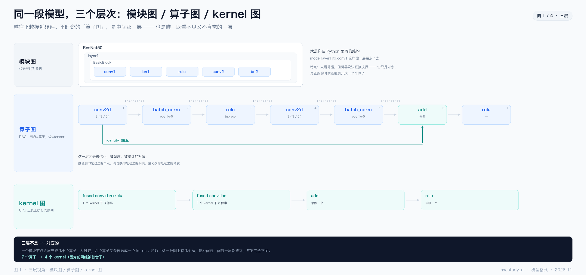
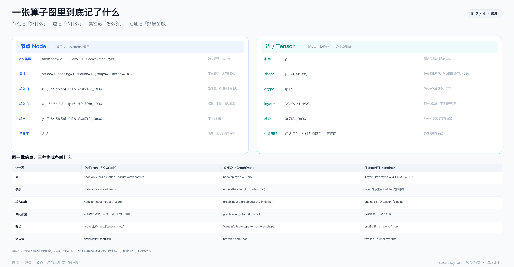
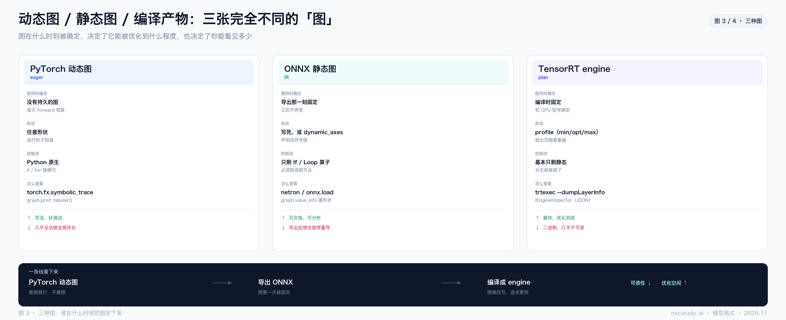
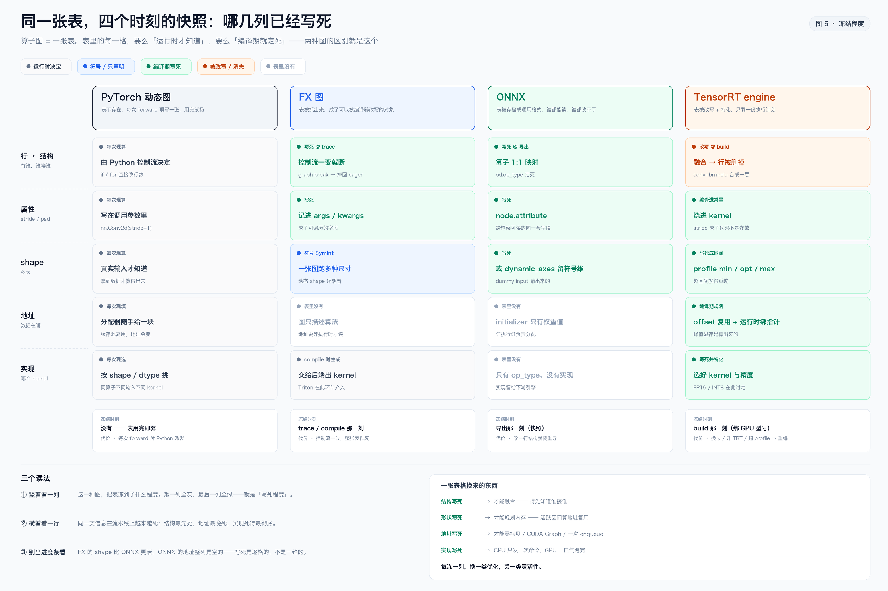
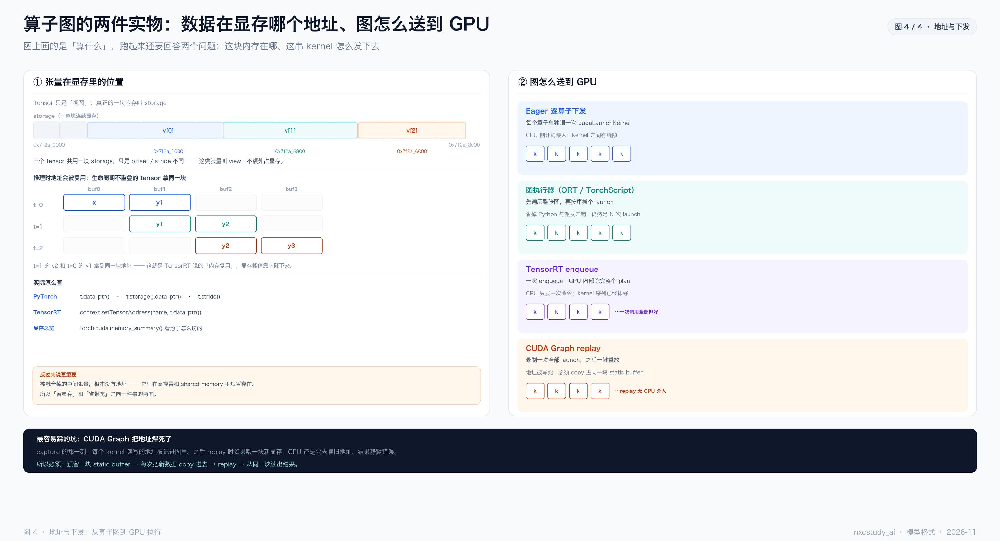

（2026-11 · 模型格式）算子图：从 PyTorch 动态图到 TensorRT engine

来源：从「一张算子图里到底有什么」这个问题出发，把四类图的写法、图上的字段（尤其是**显存地址**）、图怎么被抓出来、又怎么被发到 GPU 上，串成一条线。

一句话：**算子图就是一张表 —— 节点说「算什么」，边说「传什么」，属性说「怎么算」，地址说「数据在哪」。** 四种图（PyTorch 动态 / FX / ONNX / engine）的区别，本质是**这张表在什么时候被写死、写死到什么程度**。

> 排版版：同目录 `2026-11-算子图.pdf`（A4，11 页，含封面与页码）。
>
> 五张图在 `assets/` 下（与本文同名，仅以 `-图N-标题` 区分）：
> - `2026-11-算子图-图1-三层视角.png`
> - `2026-11-算子图-图2-节点与边.png`
> - `2026-11-算子图-图3-三种图.png`
> - `2026-11-算子图-图4-地址与下发.png`
> - `2026-11-算子图-图5-冻结程度.png`
>
> 生成脚本：`assets/_make_graph_notes.py`（图 1–4）、`assets/_make_freeze_figure.py`（图 5）

────────────────────────────

〇、先建立直觉：什么叫「图」

`y = relu(conv(x) + x)` 这一行代码，拆开就是四个算子、三条边：

```
x ──▶ conv2d ──▶ add ──▶ relu ──▶ y
        ▲         │
        └─────────┘   （x 也直接进 add，这就是残差）
```

把算子当**节点**、把 tensor 当**边**、按依赖关系连起来，就得到一张**有向无环图（DAG）**。DFS 遍历一遍就是合法的执行顺序。

**为什么要有图？** 因为只有"图"这个形态，才能被整体分析：

| 想做的事 | 需要图吗 | 说明 |
|---|---|---|
| 算子融合 | 是 | 得知道谁接谁，才能把 conv+bn+relu 合成一个 |
| 内存复用 | 是 | 得知道每个 tensor 的生死区间（图上算得出来） |
| 量化 | 是 | 得逐层插量化/反量化节点 |
| 并行调度 | 是 | 得知道哪些节点互相没依赖 |
| 逐行调试 | 否 | eager 模式反而是优势 |

**这就是「动态图灵活、静态图能优化」的根本原因**：图存不存在，决定了优化器有没有东西可以分析。

────────────────────────────

一、三层：模块图 / 算子图 / kernel 图



同一个模型，有三种完全不同的「图」，**很多人说的不是同一层**。

### ① 模块图（你写的代码）

```python
class BasicBlock(nn.Module):
    def __init__(self):
        self.conv1 = nn.Conv2d(...)
        self.bn1   = nn.BatchNorm2d(...)
        ...
```

这是**对象树**：`model.layer1[0].conv1`。它描述的是「有哪些零件」，不是「怎么算」。你 `print(model)` 看到的就是这一层。

### ② 算子图（真正被优化的层次）

`conv2d → batch_norm → relu → conv2d → batch_norm → add → relu`，每个节点都带 shape、dtype、地址。

**融合删的是这里的节点，调优换的是这里的实现，量化改的是这里的精度。** 平时讨论「模型有多少个算子」「哪里是瓶颈」，说的都是这一层。

### ③ kernel 图（GPU 上真正跑的）

融合之后，7 个算子在 GPU 上可能只剩 4 个 kernel：

```
conv+bn+relu → conv+bn → add → relu
```

**三层不是一一对应的**：一个模块节点会展开成几十个算子；反过来，几个算子又会被融成一个 kernel。所以「这个模型有多少个算子」这种问题，问哪一层都成立，**答案完全不同**。

> 常见误解：以为 `print(model)` 打出来的就是「计算图」。不是，那是模块树。想看算子图，得用第 3 节的办法去抓。

────────────────────────────

二、一张算子图里到底记了什么



### 节点记四件事

```
op 类型   aten::conv2d  →  Conv  →  IConvolutionLayer
属性      stride=1 padding=1 dilation=1 groups=1 kernel=3×3
输入      x : [1,64,56,56] fp16 @0x7f2a_1c00
          w : [64,64,3,3]  fp16 @0x7f8c_4000
输出      y : [1,64,56,56] fp16 @0x7f2a_9c00
拓扑序    #12
```

**属性不进显存**——它们是编译期就固化进 kernel 的常量（stride、padding 这类）。

### 边就是 tensor，记五件事

| 字段 | 例 | 为什么要记 |
|---|---|---|
| 名字 | `y` | 报错时靠它定位是哪个 tensor |
| shape | `[1,64,56,56]` | 静态图写死，动态图运行时才知道 |
| dtype | `fp16` | 决定一次搬运多少字节 |
| layout | `NCHW` | 同一份数据，不同遍历顺序，性能差很多 |
| **地址** | `0x7f2a_9c00` | **kernel 真正读写的位置** |
| 生命周期 | `#12 产生 → #15 消费完` | 内存复用就是靠这个算的 |

### 地址：为什么它出现在图里

图本身只描述"算什么"，但一旦要**执行**，每个节点都得知道去哪个地址读写。所以：

- **权重（initializer）**：加载时就分配好，地址全程不变
- **激活值**：运行时才分配，地址每次可能不同
- **被融合掉的中间结果**：**根本没有地址**——它只在寄存器/shared memory 里短暂存在

最后这条很关键：**融合的收益就是"让这个地址不存在"**，所以省显存和省带宽是同一件事的两面。

### 同一批信息，三种格式各叫什么

| 这一项 | PyTorch（FX） | ONNX（GraphProto） | TensorRT（engine） |
|---|---|---|---|
| 算子 | `node.op` / `node.target` | `node.op_type` | `ILayer`，`layer.type` |
| 参数 | `node.args` / `node.kwargs` | `node.attribute` | builder 内部持有 |
| 输入输出 | `node.all_input_nodes` | `graph.input/output/initializer` | I/O tensor（binding） |
| 中间张量 | 只是 node 的输出引用 | `graph.value_info` | 内部隐式，不暴露 |
| 形状 | `node.meta['tensor_meta']` | `ValueInfoProto.type.shape` | profile 的 min/opt/max |
| 怎么读 | `graph.print_tabular()` | netron / `onnx.load` | `trtexec --dumpLayerInfo` |

**换个格式，概念不变，名字全变。** 这张表建议背下来——排查问题时，你需要的字段在哪，全在这。

────────────────────────────

三、图是怎么「抓」出来的

四类来源，从"没有图"到"图被改写"，复杂度递增。

### ① Eager：根本没有持久的图

```python
y = model(x)   # 逐行执行，执行完就没了
```

训练时 PyTorch 会顺手建一张 **autograd 图**（为了反向传播），但推理时 `torch.no_grad()` 连这个都关了。**所以 eager 模式下你没有图可看。**

### ② torch.fx：把 Python 代码「录」成图

```python
import torch, torch.fx as fx

class Block(torch.nn.Module):
    def __init__(self):
        super().__init__()
        self.conv = torch.nn.Conv2d(3, 64, 3, padding=1)
        self.bn   = torch.nn.BatchNorm2d(64)
        self.relu = torch.nn.ReLU()

    def forward(self, x):
        return self.relu(self.bn(self.conv(x)))

gm = fx.symbolic_trace(Block())
print(gm.graph)
```

输出就是这个模型的算子图：

```
graph():
    %x      : [#users=1] = placeholder[target=x]
    %conv   : [#users=1] = call_module[target=conv](args = (%x,), kwargs = {})
    %bn     : [#users=1] = call_module[target=bn](args = (%conv,), kwargs = {})
    %relu   : [#users=1] = call_module[target=relu](args = (%bn,), kwargs = {})
    return relu
```

想看表格版，用 `print_tabular()`：

```python
gm.graph.print_tabular()
# opcode       name    target   args     kwargs
# ------------- ------- -------- -------- --------
# placeholder  x       x        ()       {}
# call_module  conv    conv     (x,)     {}
# ...
```

**注意 `symbolic_trace` 的限制**：它用一个假的 `Proxy` 跑一遍，遇到 `if x.sum() > 0` 这种依赖真实数值的分支就没法录（叫 **graph break**）。`torch.compile` 的 Dynamo 就是来解决这个的。

### ③ torch.onnx.export：把图转成静态格式

```python
torch.onnx.export(model, dummy_input, "model.onnx",
                  input_names=["x"], output_names=["y"],
                  opset_version=17)
```

**它做的事**：跑一次 trace → 每个 PyTorch 算子 1:1 映射成 ONNX 算子 → 把形状写进 `value_info`。

**它不做的事**：融合、kernel 选择、内存规划。**导出器的目标是"语义正确"，不是"性能好"。**

### ④ TensorRT：把图读进来再改写

```bash
trtexec --onnx=model.onnx --fp16 \
        --dumpLayerInfo --exportLayerInfo=layers.json \
        --profilingVerbosity=detailed
```

`layers.json` 里能看到每个 layer 的：类型、输入输出 tensor、精度、耗时。**这是唯一能看到"融合之后有几层"的办法。**

### ⑤ 三种抓法的对比

| 手段 | 需要模型可 trace 吗 | 控制流支持 | 产物 |
|---|---|---|---|
| `symbolic_trace` | 是 | 无（会断） | FX GraphModule |
| `torch.export` / Dynamo | 是（但更强） | 部分（可导出为节点） | ExportedProgram |
| `torch.onnx.export` | 是 | 弱 | `.onnx` |
| TensorRT | 吃 onnx | 基本没有 | `.plan` |

────────────────────────────

四、四种完全不同的「图」



| | PyTorch 动态图 | FX 图 | ONNX 静态图 | TensorRT engine |
|---|---|---|---|---|
| **图何时确定** | 没有持久的图，每次 forward 现算 | trace / compile 那一刻 | 导出那一刻固定 | 编译时固定，且绑 GPU 型号 |
| **形状** | 任意 | 可以是符号 SymInt | 写死，或 `dynamic_axes` 声明符号维 | profile（min/opt/max） |
| **控制流** | Python 原生 if/for | 一断就 graph break，掉回 eager | 只剩 If/Loop 算子 | 基本只剩静态 |
| **能否优化** | 几乎不能 | 能被编译器整图改写（torch.compile） | 有限 | 全图重写 |
| **可读性** | 高（代码就是图） | 高（还是 Python） | 高（netron） | 低（二进制） |
| **怎么读** | `print_tabular()` | `print(gm.graph)` | `onnx.load` / netron | `--dumpLayerInfo` |
| **什么时候作废** | 不存在 | 控制流一断 | 改结构要重导 | 换卡 / 升 TRT / 超 profile 要重编 |

图 3 只画了三张，因为 **FX 不落地**——它是活在进程里的一张表，不产出文件、也不进交付链。一旦要"交出去"，它必然先变成 ONNX。

### 逐格看：这四张表「冻」到了什么程度



上面那张表回答"图长什么样"，这张图回答"**表里的每一格，是活的还是死的**"。三种读法：

**① 竖着看一列 —— 冻到了什么程度。**
最左一列整列是"运行时才知道"，最右一列几乎全是"编译期写死"，中间是过渡带。
**绿格子越往右越多，就是写死程度。**

**② 横着看一行 —— 谁先死、谁后死。**

| 表的一列 | 在流水线上怎么变 |
|---|---|
| **结构**（谁接谁） | 最先死，而且死得最彻底：engine 里不是"冻结"，是**行被删掉**（融合），所以它的算子数比 ONNX 少 |
| **属性**（stride/pad） | 从调用参数 → `node.attribute` → 直接**烧进 kernel 常量** |
| **shape** | 运行时真值 → SymInt 符号 → 写死（或符号维）→ profile 区间 |
| **地址** | 最晚死：FX / ONNX 里这一列**根本是空的**，因为"图"只描述算法，地址要等执行才谈得上 |
| **实现**（哪个 kernel） | 死得最彻底：ONNX 里连这一列都不存在，只有 `op_type` |

**③ 别把它当进度条。**
写死是**逐格**的，不是一维的：FX 的 shape 比 ONNX 更活（SymInt），ONNX 的地址整列是空的。
**四张图不是四个档位，是同一张表在四个时刻的快照。**

**为什么偏偏是这个顺序**：结构 → 属性 → shape → 地址 → 实现，层层依赖。不知道谁接谁，就谈不上融合；不知道形状，就算不出地址；地址不定，做不了零拷贝；前面全定死，才敢特化 kernel。

**每冻一列，换来一类优化**：

| 冻住什么 | 换来什么 |
|---|---|
| 结构 | 算子融合 —— 得先知道谁接谁 |
| 属性 | 常量折叠、stride 特化 |
| shape | 全局内存规划（活跃区间 → 地址复用） |
| 地址 | 零拷贝、CUDA Graph、一次 enqueue |
| 实现 | CPU 只发一次命令，GPU 一口气跑完 |

代价就是上表的最后一行：**每冻一列，换一类优化，也丢一类灵活性。**

### 四种图各适合什么

**动态图**适合**还没定型的模型**。改一行代码立刻生效，调 shape、加分支都不受约束。代价是每次 forward 都要重新走一遍 Python 解释器 + 算子派发。

**FX** 适合**"被改写"**。它本身不是终点，而是编译器的工作台：`torch.compile`、量化、剪枝、图切分，都是"抓一张 FX 表 → 改它 → 再生成代码"。它的价值不在文件，在**这张表是可编程的**。

**ONNX**适合**交付和交换**。它是唯一一个"任何框架都能读"的格式，所以模型发布、跨团队交付、上云，基本都走 ONNX。但它是**快照**：导完就固定了，想改就得重导。

**engine**适合**最终部署**。图在编译期被彻底改写（融合、调优、精度），运行时只是照着跑。代价是**它不认识"新东西"**：换卡、换 TRT 版本、超出 shape profile，都得重编。

> **一句话**：`动态图 → (FX) → ONNX → engine` 是一条**单向**的路，每走一步，图的"可读性"下降，"优化程度"上升。所以要**调试往前站，优化往后走**。

────────────────────────────

五、显存地址：Tensor 到底在哪



这是最容易懵的一块，因为**同一个 tensor 有不止一个"地址"**。

### storage 与 view

```python
t = torch.randn(4, 8, device="cuda")   # 一块 storage
v = t[1:3]                             # 一个 view，不新占显存
```

- **`t.storage()`**：一整块连续显存
- **`t.data_ptr()`**：这个 tensor **第一个元素**的地址
- **`t.storage_offset()`**：相对 storage 起点的偏移
- **`t.stride()`**：每个维度走一步跨多少元素

所以 `v.data_ptr()` 不等于 `t.data_ptr()`，但 `v.storage().data_ptr()` 等于 `t.storage().data_ptr()`——**它们共用一块内存**。

**这就是为什么 `transpose` / `slice` 几乎不花时间**：它们只改元数据（offset+stride），不搬数据。也正因为如此，**不连续的 tensor 传给某些 kernel 会悄悄触发一次 copy**——这是性能问题的一个常见来源。

### 内存池与地址复用

PyTorch 不会每次 `cudaMalloc`（那太慢了），而是维护一个**缓存分配器**：释放的块回到池子里，下次申请同尺寸就直接复用。

```
t=0:  buf0=x   buf1=y1   buf2=空   buf3=空
t=1:  buf0=空  buf1=y1   buf2=y2   buf3=空     ← y2 拿到了 y1 曾经的位置
t=2:  buf0=空  buf1=空   buf2=y2   buf3=y3
```

**TensorRT 的"内存优化"就是把这个过程提前到编译期算好**：它分析每个 tensor 的活跃区间，不重叠的直接分配同一个地址。显存峰值就是这么降下来的。

### 怎么查

```python
t.data_ptr()                    # 0x7f2a1c0000
t.storage().data_ptr()          # 整块 storage 的起点
t.stride()                      # (8, 1)
torch.cuda.memory_summary()     # 看池子怎么切的
```

TensorRT 侧：

```python
engine.get_tensor_name(i)               # 输入输出的名字
context.set_tensor_address("x", x.data_ptr())
context.execute_async_v3(stream)
```

**注意**：`set_tensor_address` 只是**告诉**引擎去哪儿读写，**不复制数据**。这就是常说的"零拷贝"——也是为什么你必须自己保证这块内存在推理期间有效。

### 为什么地址这件事值得单独记

| 场景 | 地址为什么重要 |
|---|---|
| 零拷贝推理 | 传 `data_ptr()` 而不是传 tensor，省一次 H2D |
| **CUDA Graph** | capture 时地址被**写死**，replay 必须用同一块 buffer |
| 多流并发 | 两个 context 不能共用同一块输出 buffer |
| 内存池调优 | `PYTORCH_CUDA_ALLOC_CONF` 改的是池子策略 |

────────────────────────────

六、图怎么「发送」到 GPU

图在 CPU 上，算在 GPU 上，中间这一步是**下发（dispatch / launch）**。四种方式，CPU 的参与程度依次降低。

| 方式 | 一次 forward 发生什么 | CPU 开销 |
|---|---|---|
| **Eager 逐算子** | 每个算子：派发 → 选 kernel → `cudaLaunchKernel` | 最大，kernel 间有缝隙 |
| **图执行器**（ORT / TorchScript） | 先遍历整张图排好序，再挨个 launch | 省掉 Python 与派发开销，仍是 N 次 launch |
| **TensorRT enqueue** | 一次 `execute_async_v3`，GPU 内部跑完整个 plan | 只发一次命令 |
| **CUDA Graph replay** | 录制一次全部 launch，之后一键重放 | 几乎为零 |

### 一个容易被忽略的点

**"整图执行"不等于"一次 kernel"**。ORT 的图执行器仍然是 N 次 launch，省的是 CPU 侧的 Python 和派发；**只有 TensorRT 的 enqueue 和 CUDA Graph 才真的做到"CPU 只发一次"**。

### CUDA Graph 的坑：地址被焊死

```python
g = torch.cuda.CUDAGraph()
static_in = torch.empty_like(x)
with torch.cuda.graph(g):
    static_out = model(static_in)     # ← 此刻所有地址被记进图里

for _ in range(100):
    static_in.copy_(new_x)            # 必须 copy 进同一块
    g.replay()                        # 否则 GPU 还去读旧地址
```

**capture 那一刻，每个 kernel 读写的地址被固化**。如果 replay 时喂一块新显存，GPU 照样去读旧地址——不报错，结果静默错误。这是 CUDA Graph 最难查的一类 bug。

**正确姿势**：预留 static buffer → 每次把新数据 `copy_` 进去 → replay → 从同一块读结果。

────────────────────────────

七、把图「看」出来的工具清单

| 想看什么 | 用什么 | 备注 |
|---|---|---|
| PyTorch 算子图 | `fx.symbolic_trace` + `print_tabular()` | 最快，但控制流会断 |
| 更完整的 PyTorch 图 | `torch.export` | 支持更多 Python 特性 |
| ONNX 图长什么样 | [netron](https://netron.app) 拖进去 | 直观，能看 shape |
| ONNX 的字段 | `onnx.load()` 遍历 `graph.node` | 脚本化分析用这个 |
| ONNX 的 shape 对不对 | `onnx.shape_inference.infer_shapes` | 补 `value_info` |
| TRT 融合后几层 | `trtexec --dumpLayerInfo --exportLayerInfo` | **唯一能看到融合结果的办法** |
| 每层耗时 | `trtexec --exportProfile=profile.json` | 定位瓶颈层 |
| 真正下发的 kernel | **Nsight Systems** | 图上没有的，时间轴上有 |
| 每个 kernel 读写的地址 | Nsight Compute | 查 bank conflict / 访存效率 |

**最后两行最容易被忽略**：图是"应该怎么算"，时间轴是"实际怎么算"。两者对不上时（比如图上 7 个算子、时间轴上 4 个 kernel），说明发生了融合——**这正是你验证优化有没有生效的地方**。

────────────────────────────

八、五个常见误解

| # | 误解 | 实际 |
|---|---|---|
| 1 | `print(model)` 打出来的是计算图 | 那是**模块树**，不是算子图 |
| 2 | eager 模式没有图 | 训练时有 autograd 图；推理时确实没有 |
| 3 | 一个算子 = 一个 kernel | 融合后多个算子共用一个 kernel |
| 4 | 图上的 tensor 都有显存地址 | 被融合掉的中间结果**没有地址** |
| 5 | 整图执行 = 一次 kernel | ORT 仍是 N 次 launch，只有 TRT/CUDA Graph 才是一次 |

────────────────────────────

九、和已有笔记的关系

| 笔记 | 讲的是 |
|---|---|
| `2026-06-ONNX与TensorRT推理加速.md` | ONNX 与 TRT 的分工（本文第二、四节的背景） |
| `2026-11-推理加速技术路线全景.md` | 三堵墙、五条路线（本文的"上位"视角） |
| `模型格式转换笔记.md` | SAM3 项目里的 binding / `set_tensor_address` 实操（本文第五节的落地版） |
| `2026-09-PyTorch执行原理与torch.compile-CUDA-Graph-TensorRT.md` | 下发与 CUDA Graph 的细节（本文第六节） |

────────────────────────────

十、一页速记

```
一张算子图 =  节点（算什么）
            + 边（传什么：shape / dtype / layout / 地址 / 生命周期）
            + 属性（怎么算：stride / padding / groups）
            + 拓扑序（先算谁）

三层      模块图（代码结构）→ 算子图（被优化）→ kernel 图（真执行）
四张图    动态图（每次现算）→ FX（可改写的表）→ ONNX（导出固定）→ engine（编译改写）
冻结      结构先死 → 属性 → shape → 地址最晚死 → 实现死得最彻底；每冻一列，换一类优化，丢一类灵活性
地址      storage 是实体，tensor 是视图；融合后中间结果没有地址
下发      eager 逐个 launch → 图执行器排好序 → TRT 一次 enqueue → CUDA Graph 一键 replay
```

> 如果只能记一句：**图是「应该怎么算」，地址是「数据在哪」，下发是「怎么送去算」——三件事合起来才是"能跑"，图只是其中最容易被看见的那一层。**
